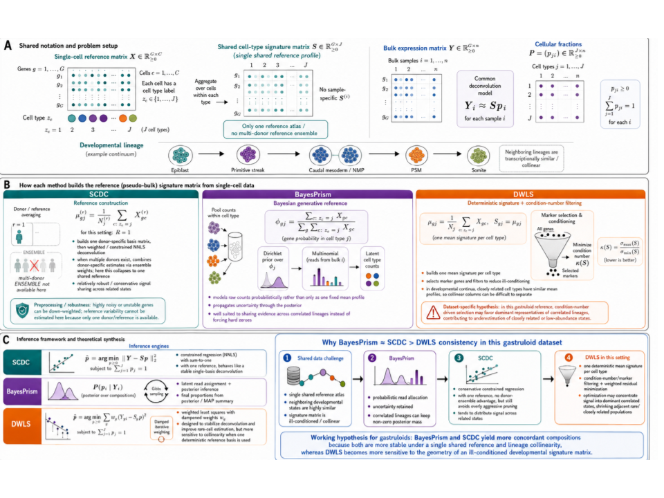

## What is being compared {#sec-deconv-models}

DeCovarT deconvolves bulk profiles with both a mean signature and a
per-type covariance. Every method below uses the same gene panel and
the same labelled single-cell reference; they differ in what they
model beyond the mean. All runs are planned on GSE229386, at 48 h,
72 h and 96 h, for the standard Wnt pulse and the early pulse
(@sec-geo-design). Each model is reviewed in
[5.1, review](https://bastienchassagnol.github.io/DeCovarT/articles/05-1-review-distribution-aware.html);
one line here says what it models and how it is called.

### Second-generation, mean-based {#sec-deconv-second-generation}

1.  **BayesPrism** (Chu et al. 2022) — a multinomial likelihood on bulk
    counts with the single-cell reference as a prior on cell-type
    expression, updated by Gibbs sampling. R, `BayesPrism`:
    `new.prism()`, `run.prism()`, `get.fraction()`.
2.  **SCDC** (Dong et al. 2021) — weighted non-negative least squares
    with clipped gene weights, and an ensemble over several references.
    With one reference the ensemble step does nothing. R, `SCDC`:
    `SCDC_prop()`, or `SCDC_prop_ONE()` for a one-subject reference.
3.  **DWLS** [@tsoucasAccurateEstimationCelltype2019] — dampened
    weighted least squares, weights the inverse squared fitted mean,
    capped by a dampening constant. R, `DWLS`: `solveDampenedWLS()`.

<!-- TODO-cite: Chu et al. 2022 (BayesPrism, key chuCellTypeGeneExpression2022) and Dong et al. 2021 (SCDC, key dongSCDCBulkGene2021) are in DeCovarT inst/REFERENCES.bib, not in bibliography/REFERENCES.bib. -->

### Single-cell likelihood strategy {#sec-deconv-single-cell}

4.  **DeCovarT, profile Newton** — the linear single-cell layer, with
    $\boldsymbol{\Sigma}_{W,j}$ weighted by $p_{ji}$ and both sample
    scales profiled out, maximised by trust-region Newton in ILR
    coordinates
    ([2.1, profile Newton](https://bastienchassagnol.github.io/DeCovarT/articles/02-1-single-cell-generative-optimisation.html#sec-profile-newton)).
    R: `DeCovarT::deconvolute_single_cell(optimiser = "newton")`.
5.  **DeCovarT, Levenberg–Marquardt** — the released population
    convolution, covariance $\sum_j p_{ji}^{2}\boldsymbol{\Sigma}_j$,
    maximised by `marqLevAlg` in ILR coordinates. With a one-specimen
    reference the quadratic slot is the wrong one
    ([2.1, one replicate](https://bastienchassagnol.github.io/DeCovarT/articles/02-1-single-cell-generative-optimisation.html#sec-one-replicate));
    the fit is the reference point for the released model.
    R: `DeCovarT::deconvolute_ratios_Marquardt_Levenberg()`.
6.  **RNA-Sieve** [@erdmann-phamLikelihoodbasedDeconvolutionBulk2021]
    — genes independent; a central-limit Gaussian bulk whose variance
    is linear in the cell count, with the reference means as noisy
    regressors and sandwich intervals. Python, `rnasieve`
    (`songlab-cal/rna-sieve`): `model_from_raw_counts()`, then
    `predict()`.
7.  **MEAD** [@xieRobustStatisticalInference2023] — an estimating
    equation corrected for reference measurement error, with
    gene–gene dependence in the sandwich variance and intervals for
    $\boldsymbol{p}$. R, `MEAD` (`DongyueXie/MEAD`): `MEAD()`.
8.  **ReDeconv** [@luTranscriptomeSizeMatters2025] — keeps the
    transcriptome size $S_j$ in the reference, corrects gene length on
    the bulk side only, and models the within-type variance through a
    central-limit law over cells. Code `jyyulab/redeconv`; entry point
    to be taken from its tutorial.

### Gold-standard baselines {#sec-deconv-baselines}

9.  **NNLS** — non-negative least squares on the mean signature, then
    projection on the simplex; homoscedastic, mean only. R:
    `DeCovarT::deconvolute_ratios_nnls()`, which calls `nnls::nnls()`.
10. **Robust linear regression (RLM)** — Huber M-estimation of
    $\boldsymbol{y}\approx\boldsymbol{\mu}\boldsymbol{p}$, which
    down-weights outlying genes. R: `DeCovarT::deconvolute_ratios_rlm()`,
    which calls `MASS::rlm(method = "M")`.

```{r}
#| label: deconv-calls
#| eval: false
# Not run. y: one bulk sample (G genes, raw counts); mu: G x J mean
# signature; sigma_w: G x G x J within-type covariances; sigma_pop:
# G x G x J covariances for the population convolution. Same panel and
# reference for every method.
fit_newton <- DeCovarT::deconvolute_single_cell(
  y, mu, sigma_w, optimiser = "newton"
)
fit_ml <- DeCovarT::deconvolute_ratios_Marquardt_Levenberg(
  y, mu, sigma_pop
)
fit_nnls <- DeCovarT::deconvolute_ratios_nnls(y, mu)
fit_rlm <- DeCovarT::deconvolute_ratios_rlm(y, mu)
# Third-party packages (not in renv.lock); check signatures first.
# BayesPrism::new.prism(); BayesPrism::run.prism(); BayesPrism::get.fraction()
# SCDC::SCDC_prop_ONE()
# DWLS::solveDampenedWLS(S, B)
# MEAD::MEAD()
```

## Statistical interpretation of the results {#sec-deconv-interpretation}

Second-generation methods differ in how they build the cell-type reference from the same labelled cells. Those that keep a gene only when it lowers the condition number of the mean signature select for separation of the means.

That rule is a poor match to the gastruloid reference. Labelled states at 48 h, 72 h and 96 h lie on a continuum, so neighbouring types have nearly collinear mean profiles and the condition number of the mean matrix is large (@fig-kappa-gastruloid). Minimising that number retains genes that separate a few dominant lineages and drops genes that distinguish closely related types through their covariance. Mean-only pruning therefore under-represents adjacent embryonic states.

{#fig-kappa-gastruloid}
