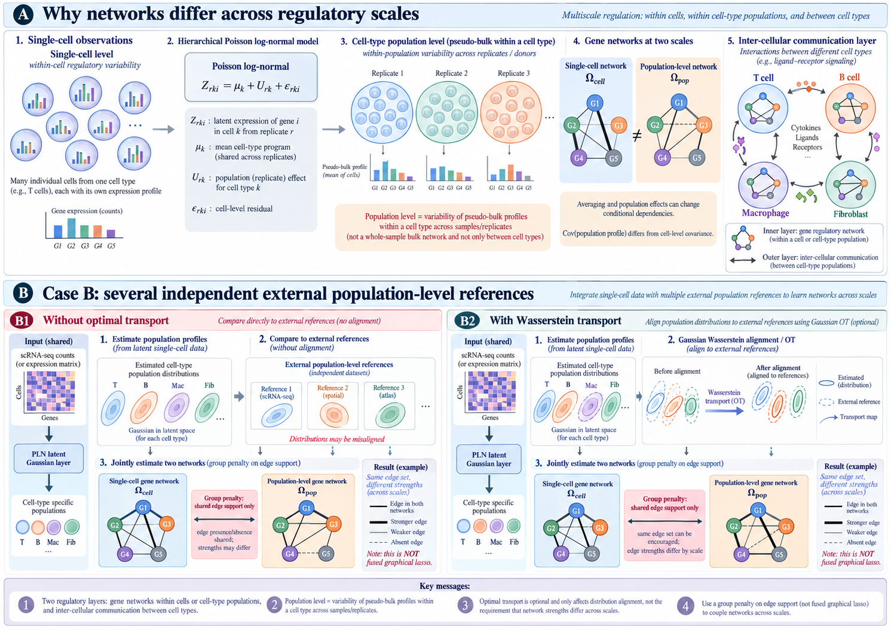

DeCovarT does not ingest single-cell profiles. It needs, for each labelled
type $j$, a population-level Gaussian
$(\boldsymbol{\mu}_{\cdot j},\boldsymbol{\Sigma}_{j})$ whose precision is sparse.
This chapter is about **lifting** cell-level observations to that object,
and about **checking** that the lift still represents the cells.

## Alignment of type-level Gaussians {#sec-align}

Two strategies are in the core. Optimal transport and mechanistic
simulators are perspectives (@sec-align-ot).

1.  **Affine invariance.** Closed-form means and covariances when cells
    of one type are independent Gaussians.
2.  **Resampling.** A technical bootstrap of cells, and Monte Carlo
    from `scDesign3`, with negative-binomial GAMLSS margins and a
    Gaussian copula tied to the sparse precision (@sec-align-mc). @fig-align-layout summarises the two routes.

```{.tikz}
%%| label: fig-align-layout
%%| fig-cap: Core lifts from labelled cells of one type to a population Gaussian: an affine aggregation, and resampling (bootstrap or scDesign3). The bulk profile is a later convolution across types.
%%| filename: fig-align-layout
%%| alt: Flowchart. Cells of type j split into two routes. An affine lift gives the closed-form mean and covariance; a bootstrap or scDesign3 resampling gives them by Monte Carlo. Both routes meet in the population Gaussian mu_j, Sigma_j, which feeds the DeCovarT convolution across types.
\begin{tikzpicture}[node distance=9mm and 14mm]
\node[keybox] (A) {Cells of type $j$};
\node[box, below left=of A, xshift=-6mm] (B) {Affine lift\\ $\boldsymbol{\mu}_{\cdot j}$, $\boldsymbol{\Sigma}_{j}$ closed form};
\node[box, below right=of A, xshift=6mm] (D) {Bootstrap or\\ \texttt{scDesign3}};
\node[dimbox, below=of $(B)!0.5!(D)$] (E) {$\boldsymbol{\mu}_{\cdot j}$, $\boldsymbol{\Sigma}_{j}$\\ population Gaussian};
\node[keybox, below=of E] (F) {DeCovarT convolution across types};
\draw[edge] (A) -- (B);
\draw[edge] (A) -- (D);
\draw[edge] (B) -- (E);
\draw[edge] (D) -- (E);
\draw[edge] (E) -- (F);
\end{tikzpicture}
```

{#fig-scdesign2-schematic}

::: {#nte-not-y .callout-warning}
## :warning: A within-type sum is not the bulk convolution

Write $\boldsymbol{x}_{c\cdot j}$ for cell $c$ of type $j$. The object of
this chapter is a sum **inside** one type,

$$
\widetilde{\boldsymbol{x}}_{\cdot j}
=
\sum_{c\in C_{j}} w_{c}\,\boldsymbol{x}_{c\cdot j},
$$ {#eq-type-sum}

with $\sum_{c}w_{c}=1$ or $w_{c}\equiv 1$. Independent cells add means
and add covariances with weights $w_{c}^{2}$. That sum estimates
$\boldsymbol{\mu}_{\cdot j}$ and $\boldsymbol{\Sigma}_{j}$.

The DeCovarT observation is a convolution **across** types,

$$
\boldsymbol{y}
=
\sum_{j=1}^{J} p_{j}\,\boldsymbol{x}_{\cdot j}^{\mathrm{pop}},
\qquad
\mathrm{Cov}(\boldsymbol{y})
=
\sum_{j}p_{j}^{2}\boldsymbol{\Sigma}_{j}.
$$ {#eq-total-bulk}

The factor $p_{j}^{2}$ belongs to that convolution. This chapter
compares $\{\boldsymbol{x}_{c\cdot j}\}_{c\in C_{j}}$ with
$\mathcal{N}(\boldsymbol{\mu}_{\cdot j},\boldsymbol{\Sigma}_{j})$.
:::

## Which covariance to export {#sec-align-which-model}

DeCovarT today is a Gaussian convolution of one population profile per
type. The covariance weight is quadratic in the cell fraction. That
object is a **between-replicate** phenotype, not the scatter of cells
inside one donor. The three layers are drawn in
@fig-three-variability. `MuSiC`'s library-size assumptions, including
the extra A3$'$ hypothesis needed for absolute cell fractions, are in
@fig-music-assumptions.

{#fig-three-variability fig-alt="Schematic of three covariance layers: linear within-cell variability, quadratic between-sample variability, and diagonal bulk measurement noise."}

{#fig-music-assumptions fig-alt="MuSiC model assumptions A1 same population, A2 conserved cell-size ratios, A3 conserved library-size ratios, and A3-prime for absolute cell-type proportions."}

Before droplet scRNA-seq, the reference was a FACS- or MACS-purified
bulk library. Szaniszlo et al. showed that mixture expression reflects
composition, that a minor subset is recovered only after physical
sorting, and that coexpression among genes inside a purified type is
already a population-level object [@szaniszloGettingRightCells].
Novershtern et al. profiled 38 marker-defined haematopoietic
populations and used coexpression modules plus promoter *cis*-circuits
as the gene–gene structure of each state
[@novershternDenselyInterconnectedTranscriptional2011]. Those FACS
profiles still match DeCovarT's quadratic convolution.

Cells from one donor share genetic and environmental background, so they
are subsamples rather than independent biological units
[@zimmermanPracticalSolutionPseudoreplication2021]. Zimmerman, Espeland
and Langefeld document that dependence across cell types, contrast
within-donor cell variation with between-donor biological variation, and
treat donor as the random effect when comparing conditions. That
within-versus-between split is the same hierarchy as
$\boldsymbol{\Sigma}_{W,j}$ versus $\boldsymbol{\Sigma}_{B,j}$ when a
single-cell reference is aligned with bulk. Technical library-size and
platform scale sit in a third, residual layer
(@fig-music-assumptions). `Squair` et al. make the same point for
false discoveries if cells are treated as biological replicates
[@squairConfrontingFalseDiscoveries2021].

The package outlook
[DeCovarT perspectives](https://bastienchassagnol.github.io/DeCovarT/articles/theory-decovart-statistical-perspectives.html#sec-sc-moments)
derives the moments. The practical fork on this gastruloid is the
reference design.

### One biological replicate

Identify the per-cell mean by the arithmetic mean of raw counts, and
the within-cell covariance $\boldsymbol{\Sigma}_{W,j}$. Do not identify a
between-replicate covariance: one donor is one draw of the replicate
effect, and more cells only shrink the average of the cell noise.

Use a linear mixture covariance

$$
\kappa_i\sum_j p_{ji}\,\boldsymbol{\Sigma}_{W,j}
+
\boldsymbol{\Sigma}_{\mathrm{obs},i},
$$ {#eq-align-linear}

with $\kappa_i$ an effective inverse cell count for the bulk, and
$\boldsymbol{\Sigma}_{\mathrm{obs},i}$ diagonal. Keep a quadratic term only
for the Monte Carlo error of the reference mean,
$\boldsymbol{\Sigma}_{W,j}/C_{j1}$, and label it as such.

Report RNA fractions unless the transcriptome sizes $S_j$ are
measured. If they are measured, insert them in the mean. Do not
estimate them jointly with $\boldsymbol{p}$, and do not estimate a
gene-wise platform vector on the same bulk sample
(@fig-music-assumptions).

### Enough biological replicates

$R\ge 2$ is the smallest design that identifies a variance component,
by contrasting the covariance of replicate means with
$\boldsymbol{\Sigma}_{W,j}/C_{jr}$. An unstructured gene-by-gene
between-replicate covariance is not estimable at transcriptome scale
for the replicate counts of a normal single-cell study. Estimate a
sparse or low-rank precision for $\boldsymbol{\Sigma}_{B,j}$. `MEAD` states
the same small-$R$ constraint on scRNA-seq references
[@xieRobustStatisticalInference2023].

The bulk model is then the three-layer normal likelihood

$$
\begin{aligned}
\mathbb{E}[\boldsymbol{y}_{\cdot i}]
&=
a_i\sum_j p_{ji}\,\boldsymbol{\mu}_{\cdot j},\\
\operatorname{Cov}(\boldsymbol{y}_{\cdot i})
&=
\sum_j p_{ji}^{2}\,\boldsymbol{\Sigma}_{B,j}
+
\kappa_i\sum_j p_{ji}\,\boldsymbol{\Sigma}_{W,j}
+
\boldsymbol{\Sigma}_{\mathrm{obs},i}.
\end{aligned}
$$ {#eq-align-three-layer}

$a_i$ is one positive scale per bulk sample.
$\boldsymbol{\Sigma}_{\mathrm{obs},i}$ stays diagonal because gene–gene
correlation already sits in the two biological layers.

Summing cells remains the right pseudobulk for `DESeq2`-style
differential expression of one cell type across donors
[@loveModeratedEstimationFold2014]. It is the wrong signature
column, because the capture count would enter $\boldsymbol{p}$.

Second-generation engines already implement pieces of this split.
`MuSiC` and `MuSiC2` weight genes by cross-subject versus cross-cell
consistency [@wangBulkTissueCell2019; @fanMusic2CellTypeDeconvolution2022].
`DWLS` averages cells for the mean and sums them to simulate bulk
[@tsoucasAccurateEstimationCelltype2019]. `Bisque` learns a gene-wise
platform map from paired assays [@jewAccurateEstimationCell2020].
`RNA-Sieve` and `MEAD` treat the reference as an errors-in-variables
design [@erdmann-phamLikelihoodbasedDeconvolutionBulk2021;
@xieRobustStatisticalInference2023]. `DECALS` estimates a
subject-specific bulk covariance and returns asymptotic intervals
[@caiStatisticalInferenceCelltype2024]. `RCTD` is the spatial analogue
for platform-corrected reference uncertainty
[@cableRobustDecompositionCell2022a]. `ReDeconv` keeps transcriptome
size in the reference [@luTranscriptomeSizeMatters2025].

## Affine lift and the precision-sparsity caveat {#sec-align-invariance}

### Independent Gaussian cells

Assume, for a fixed type $j$ (subscript dropped),

$$
\boldsymbol{x}_{c}
\sim
\mathcal{N}_{G}(\boldsymbol{\mu}_{c},\boldsymbol{\Sigma}_{c})
\quad\text{independent in }c.
$$ {#eq-cell-gauss}

Affine closure of multivariate Gaussians
([linear transformation theorem](https://statproofbook.github.io/P/mvn-ltt.html))
gives

$$
\widetilde{\boldsymbol{x}}
=
\sum_{c} w_{c}\boldsymbol{x}_{c}
\sim
\mathcal{N}_{G}\!\left(
\sum_{c}w_{c}\boldsymbol{\mu}_{c},\;
\sum_{c}w_{c}^{2}\boldsymbol{\Sigma}_{c}
\right).
$$ {#eq-affine}

Special cases used in practice:

| Weights | Mean | Covariance | Precision |
|---------|------|------------|-----------|
| $w_{c}=1$ (sum of $n$ i.i.d. cells) | $n\boldsymbol{\mu}$ | $n\boldsymbol{\Sigma}$ | $n^{-1}\boldsymbol{\Omega}$ |
| $w_{c}=1/n$ (average) | $\boldsymbol{\mu}$ | $n^{-1}\boldsymbol{\Sigma}$ | $n\boldsymbol{\Omega}$ |
| $w_{c}=S_{c}/\sum S_{c'}$ (library-size weights) | $\sum w_{c}\boldsymbol{\mu}_{c}$ | $\sum w_{c}^{2}\boldsymbol{\Sigma}_{c}$ | inverse of that sum |

Zeros of $\boldsymbol{\Omega}$ survive the sum **only when every cell
shares the same covariance**. If
$\boldsymbol{\Sigma}_{c}=\boldsymbol{\Sigma}$ for all $c$, then
$\boldsymbol{\Sigma}_{\widetilde{\boldsymbol{x}}}=(\sum_{c}w_{c}^{2})\boldsymbol{\Sigma}$
and

$$
\boldsymbol{\Omega}_{\widetilde{\boldsymbol{x}}}
=
\frac{1}{\sum_{c}w_{c}^{2}}\,\boldsymbol{\Omega},
$$ {#eq-theta-scale}

so the zero pattern is unchanged. If the cells have different
$\boldsymbol{\Sigma}_{c}$,

$$
\boldsymbol{\Omega}_{\widetilde{\boldsymbol{x}}}
=
\Bigl(\sum_{c}w_{c}^{2}\boldsymbol{\Sigma}_{c}\Bigr)^{-1},
$$ {#eq-theta-sum}

and inversion does not commute with summation. A gastruloid label is
already a continuum, so heterogeneous cells inside one type break a
naïve transfer of sparsity.

**Core use.** Treat labelled cells of type $j$ as exchangeable draws
from one $\mathcal{N}(\boldsymbol{\mu}_{\cdot j},\boldsymbol{\Sigma}_{j})$,
estimate that law (graphical lasso, `SILGGM`, or `PLNnetwork`), and
export it. @eq-affine then describes a pseudo-bulk of i.i.d. draws from
that same law. If `GmGM` (@sec-gmgm) finds a non-trivial cell-axis
precision, the i.i.d. hypothesis is already false and @eq-theta-scale
is an approximation.

### Mean and covariance that DeCovarT actually wants

DeCovarT's $\boldsymbol{\mu}_{\cdot j}$ is a cross-cell mean of the
purified profile, analogous to MuSiC's cross-sample mean
[@wangBulkTissueCell2019]. Empirically,

$$
\widehat{\boldsymbol{\mu}}_{\cdot j}
=
\frac{1}{n_{j}}\sum_{c\in C_{j}}\boldsymbol{x}_{c\cdot j}
\quad\text{(linear scale)},
$$ {#eq-mu-hat}

and $\widehat{\boldsymbol{\Sigma}}_{j}$ comes from the GGM or PLN fit
on the gene panel. The unstructured sample covariance of thousands of
genes is singular for $G>n_{j}$ and dense. The sparse precision is
inverted to an SPD covariance for the likelihood. The convolution uses
$\boldsymbol{\Sigma}_{j}$ of the **population profile**, the same object
whose mean is $\boldsymbol{\mu}_{\cdot j}$.

## Bootstrap {#sec-align-bootstrap}

Resample cells **with replacement within type**, labels fixed. Each
replicate yields
$(\hat{\boldsymbol{\mu}}^{\ast},\widehat{\boldsymbol{\Omega}}^{\ast})$
and therefore edge-inclusion frequencies (@sec-metrics-stat) and Monte
Carlo error for MixSim overlap and for downstream
$\hat{\boldsymbol{p}}$.

This uncertainty is conditional on this gastruloid experiment. It does
not stand in for organoid-to-organoid variability
[@squairConfrontingFalseDiscoveries2021]. Calling technical
pseudo-bulks biological replicates is the error flagged in
@nte-pseudoreplication. Multiple donors would allow resampling of
experimental units. Suppinger does not provide them. External cohorts
(for example GSE250136) are for validation.

## `scDesign3` with a precision-based copula {#sec-align-mc}

`scDesign3` fits a joint count model to cells, then draws synthetic
cells from it [@songScDesign3GeneratesRealistic2024]. Each gene gets
its own margin, a generalised additive model for location, scale and
shape (GAMLSS) in the cell covariates. A copula then joins the genes,
which keeps the margins fixed while modelling pairwise dependence. The
likelihood splits into a marginal part and a copula part, so AIC and
BIC can score each part separately. With cell type as the only cell
covariate, the model reduces to `scDesign2`, which fits one margin per
gene and type and an empirical Gaussian copula per type
[@sunScDesign2TransparentSimulator2021].

The arm used here keeps that layout and changes the dependence:
margins are negative binomial, and the copula correlation is the
correlation matrix of
$\widehat{\boldsymbol{\Sigma}}_{j}=\widehat{\boldsymbol{\Omega}}_{j}^{-1}$
(@fig-scdesign3). @fig-scdesign2-schematic shows the same sparse-copula arm in
its scDesign2 form, with the fitting and generating steps spelled out.

::: {.callout-note}
## :information_source: Out of scope

`scDesign3` also simulates continuous trajectories (pseudotime
smoothers), spatial transcriptomics (Gaussian-process smoothers on
coordinates) and multi-omic or multimodal profiles. DeCovarT is a
static model of labelled cell types, so this chapter uses only the
cell-type covariate, the GAMLSS margins, the copula and the
likelihood-based model selection.
:::

```{.tikz}
%%| label: fig-scdesign3
%%| fig-cap: The `scDesign3` arm used here, in plate notation. (a) Negative-binomial GAMLSS margins fitted gene by gene, with mean and dispersion depending on the labelled cell type and the mean offset by the library size. (b) A Gaussian copula whose correlation $\boldsymbol{R}_j$ is the correlation matrix of the exported sparse covariance $\widehat{\boldsymbol{\Omega}}_j^{-1}$; the latent normal vector is mapped to uniforms and then through the inverse margins of (a).
%%| filename: fig-scdesign3
%%| alt: Two panels. Panel a: inside a gene plate, fixed coefficients alpha_g and beta_g; inside a nested cell plate, the deterministic mean mu_cg depends on alpha_g, the fixed cell-type labels and library sizes, and the deterministic dispersion psi_cg depends on beta_g and the cell-type labels; both generate the observed count X_cg through a negative binomial. Panel b: the fixed sparse precision Omega_j gives the deterministic correlation R_j; inside a cell plate, a latent normal vector z_c with correlation R of the cell's type is mapped to uniforms u_c, which together with the margins of panel a give the observed counts X_c.
\begin{tikzpicture}
\tikzset{ptitle/.style={font=\bfseries\small, anchor=south west}}
% (a) GAMLSS margins
\begin{scope}
\node[const] (x) at (-2.0,0) {$\boldsymbol{j}$};
\node[note, left=1mm of x] {cell types};
\node[const] (L) at (-2.0,-1.6) {$\boldsymbol{L}$};
\node[note, left=1mm of L] {library sizes};
\node[const] (al) at (0.4,0) {$\boldsymbol{\alpha}_{g}$};
\node[const] (be) at (2.6,0) {$\boldsymbol{\beta}_{g}$};
\node[det] (mu) at (0.4,-2.4) {$\mu_{cg}$};
\node[det] (ps) at (2.6,-2.4) {$\psi_{cg}$};
\node[obs] (X) at (1.5,-4.4) {$X_{cg}$};
\node[note, below=2mm of X, align=center] (nX) {$X_{cg}\sim\mathrm{NB}(\mu_{cg},\psi_{cg})$\\ $\log\mu_{cg}=\alpha_{g0}+\alpha_{g\,j(c)}+\log L_c$\\ $\log\psi_{cg}=\beta_{g0}+\beta_{g\,j(c)}$};
\draw[edge] (al) -- (mu); \draw[edge] (be) -- (ps);
\draw[edge] (x) -- (mu); \draw[edge] (x) to[bend left=25] (ps); \draw[edge] (L) -- (mu);
\draw[edge] (mu) -- (X); \draw[edge] (ps) -- (X);
\plate{cells}{(mu)(ps)(X)(nX)}{$c=1,\ldots,n$}
\plate{genes}{(al)(be)(cells)(cells-lab)}{$g=1,\ldots,G$}
\node[ptitle] at (-3.4,1.0) {(a) GAMLSS margins, one gene at a time};
\end{scope}
% (b) Gaussian copula from the sparse precision
\begin{scope}[xshift=100mm]
\node[const] (Om) at (0,0) {$\widehat{\boldsymbol{\Omega}}_{j}$};
\node[det] (R) at (2.4,0) {$\boldsymbol{R}_{j}$};
\node[note, right=1mm of R] (nR) {correlation of $\widehat{\boldsymbol{\Omega}}_{j}^{-1}$};
\node[const] (x) at (-0.8,-2.4) {$j(c)$};
\node[stoch] (z) at (1.2,-2.4) {$\boldsymbol{z}_{c}$};
\node[det] (u) at (3.2,-2.4) {$\boldsymbol{u}_{c}$};
\node[det] (th) at (5.2,-2.4) {$\boldsymbol{\mu}_{c},\boldsymbol{\psi}_{c}$};
\node[obs] (X) at (3.2,-4.4) {$\boldsymbol{X}_{c}$};
\node[note, below=1mm of z] (nz) {$\mathcal{N}_G(\boldsymbol{0},\boldsymbol{R}_{j(c)})$};
\node[note, above=1mm of u] (nu) {$\Phi(\boldsymbol{z}_c)$};
\node[note, below=2mm of X] (nX) {$X_{cg}=F^{-1}_{cg}(u_{cg})$, margins from (a)};
\draw[edge] (Om) -- (R); \draw[edge] (R) -- (z); \draw[edge] (x) -- (z);
\draw[edge] (z) -- (u); \draw[edge] (u) -- (X); \draw[edge] (th) -- (X);
\plate{cellsb}{(x)(z)(u)(th)(X)(nz)(nu)(nX)}{$c=1,\ldots,n$}
\node[ptitle] at (-1.6,1.0) {(b) Gaussian copula with a sparse precision};
\end{scope}
\end{tikzpicture}
```

### Margins: a GAMLSS per gene {#sec-scd3-margins}

In `scDesign3` notation, cell $i$ has state covariates $\boldsymbol{x}_i$
(cell type, pseudotime or coordinates) and design covariates
$\boldsymbol{z}_i=(b_i,c_i)$ (batch and condition). Feature $j$ follows
a distribution $F_j$ whose mean, scale and zero-inflation parameters
each have their own additive predictor (equation 1 of the paper):

$$
\begin{aligned}
Y_{ij}\mid\boldsymbol{x}_i,\boldsymbol{z}_i
&\overset{\text{ind}}{\sim}F_j(\cdot\mid\boldsymbol{x}_i,\boldsymbol{z}_i;\mu_{ij},\sigma_{ij},p_{ij}),\\
\theta_j(\mu_{ij})&=\alpha_{j0}+\alpha_{jb_i}+\alpha_{jc_i}+f_{jc_i}(\boldsymbol{x}_i),\\
\log\sigma_{ij}&=\beta_{j0}+\beta_{jb_i}+\beta_{jc_i}+g_{jc_i}(\boldsymbol{x}_i),\\
\operatorname{logit}p_{ij}&=\gamma_{j0}+\gamma_{jb_i}+\gamma_{jc_i}+h_{jc_i}(\boldsymbol{x}_i).
\end{aligned}
$$ {#eq-gamlss}

$\theta_j$ is the link of the mean. $F_j$ is one of Gaussian,
Bernoulli, Poisson, negative binomial, zero-inflated Poisson or
zero-inflated negative binomial. When only $\mu_{ij}$ depends on the
covariates, @eq-gamlss is a generalised additive model (GAM); the
GAMLSS adds predictors for the scale and the zero-inflation. The fit is
`gamlss()` from `gamlss` or `gam()` from `mgcv`
[@songScDesign3GeneratesRealistic2024].

The smooth terms $f,g,h$ are what make the model additive: cubic
regression splines along pseudotime, or Gaussian-process smoothers on
spatial coordinates. For a categorical cell type
$x_i\in\{1,\ldots,K\}$ they collapse to one coefficient per type,
$f_{jc_i}(x_i)=\alpha_{jc_ix_i}$. In this chapter's notation (cell $c$,
gene $g$, type $j(c)$, library size $L_c$), the arm fits

$$
X_{cg}\sim\mathrm{NB}(\mu_{cg},\psi_{cg}),
\qquad
\log\mu_{cg}=\alpha_{g0}+\alpha_{g\,j(c)}+\log L_c,
\qquad
\log\psi_{cg}=\beta_{g0}+\beta_{g\,j(c)},
$$ {#eq-nb-gamlss}

which is the per-type negative binomial of `scDesign2` written as a
GAMLSS: $\mu_{gj}$ and $\psi_{gj}$ are free per type, and the dispersion
is allowed to differ between types. The library size enters the mean as
an offset; replacing the offset by a covariate with a free slope is an
ordinary GAMLSS term and tests whether expression scales
proportionally with depth. Zero-inflated margins are not used
(@nte-drop-zico).

GAMLSS terms that do matter for DeCovarT, even without trajectories:

- **Dispersion by type.** The negative-binomial dispersion is a scale
  parameter. Letting $\log\psi$ depend on the type is the GAMLSS
  feature that a GAM lacks.
- **Design covariates.** Batches or sampling time points enter as
  $\alpha_{gb}$ and $\beta_{gb}$. Setting those coefficients to zero at
  generation produces synthetic cells without the batch effect.
- **Smooth terms.** These are only needed when a continuous covariate
  is modelled, such as developmental time inside one labelled type.
  That is a perspective here, because DeCovarT's reference is static.

### Joint law: copula choices with fixed margins {#sec-scd3-copula}

The joint distribution factors by Sklar's theorem (@thm-sklar): the
gene-wise cdfs $F_{cg}$ carry the margins, and a copula $C$ carries the
dependence,

$$
F(\boldsymbol{x}_{c}\mid j(c))
=C\bigl(F_{c1}(x_{c1}),\ldots,F_{cG}(x_{cG})\mid j(c)\bigr).
$$

Because the margins are fitted first and held fixed, the copula changes
only the pairwise dependence. Three copulas are available.

| Copula | Dependence parameters per type | High-dimensional likelihood | What it shows |
|---|---|---|---|
| Empirical Gaussian (`scDesign2`; option in `scDesign3`) | $G(G-1)/2$ correlations | Fails when $G>n_j$: $\widehat{\boldsymbol{R}}_j$ is singular | A correlation matrix |
| Vine (`scDesign3`) | One bivariate copula per edge of $G-1$ trees | Always defined; slow | The first tree: genes that act as hubs |
| Precision-based Gaussian (this arm) | $\lvert E_j\rvert$ non-zero partial correlations | Always defined: $\widehat{\boldsymbol{\Omega}}_j\succ 0$ | A conditional-independence graph |

: Copulas that keep negative-binomial margins fixed and model pairwise gene dependence. $\lvert E_j\rvert$ is the number of edges of the sparse precision of type $j$. {#tbl-copulas}

**Empirical Gaussian copula.** `scDesign3` estimates
$\boldsymbol{R}(\boldsymbol{x}_i,\boldsymbol{z}_i)$ as the sample
correlation of $\Phi^{-1}(\boldsymbol{u})$ among cells with the same
covariates (`cora()` in `Rfast`). The authors note that when the number
of genes is large, $\widehat{\boldsymbol{R}}$ is not invertible and the
likelihood cannot be computed [@songScDesign3GeneratesRealistic2024].

**Vine copula.** A regular vine decomposes the $G$-dimensional copula
density into bivariate copulas along a sequence of $G-1$ trees, each
conditioning on the previous ones (`vinecop()` in `rvinecopulib`). The
density is always defined. The first tree is interpretable: in
peripheral blood cells, it recovered canonical markers such as *LYZ*
for CD14$^{+}$ monocytes and *CD79A* for B cells as hub genes. Fitting
is slow in high dimension [@songScDesign3GeneratesRealistic2024].

**Precision-based Gaussian copula.** This arm does not estimate the
copula from the counts. The latent map
$z_{cg}=\Phi^{-1}(u_{cg})$ is the same idea as `huge.npn()` followed by a
Gaussian precision (@sec-huge, @sec-silggm, @nte-npn-derivation):
monotone margins, then a Gaussian vector. `SILGGM` estimates the
precision of those scores. Here the precision is the exported
$\widehat{\boldsymbol{\Omega}}_{j}$, and the copula is not refit. The
correlation that enters the copula is

$$
R_{gg'}
=
\frac{\Sigma_{gg'}}{\sqrt{\Sigma_{gg}\,\Sigma_{g'g'}}},
\qquad
\boldsymbol{\Sigma}
=
\widehat{\boldsymbol{\Omega}}_{j}^{-1}.
$$ {#eq-copula-r}

$R$ is the correlation of that covariance. It is not the matrix of
partial correlations, and it is not the Pearson correlation of the raw
counts. Its inverse is
$\boldsymbol{R}^{-1}=\boldsymbol{D}^{1/2}\widehat{\boldsymbol{\Omega}}_j\boldsymbol{D}^{1/2}$
with $\boldsymbol{D}=\operatorname{diag}(\boldsymbol{\Sigma})$, so the zero
pattern of $\widehat{\boldsymbol{\Omega}}_j$ survives: two genes with a
zero partial correlation are conditionally independent on the latent
normal scale. The copula matches the network only if
$\widehat{\boldsymbol{\Omega}}_j$ was estimated on the normal scores, as
`SILGGM` does after the nonparanormal map; a precision estimated on
linear counts gives a correlation on another scale.

::: {#thm-sklar}
## Sklar's theorem

Let $F$ be a $G$-dimensional cdf with margins $F_{1},\ldots,F_{G}$.
There exists a copula $C:[0,1]^{G}\to[0,1]$ such that

$$
F(x_{1},\ldots,x_{G})
=
C\bigl(F_{1}(x_{1}),\ldots,F_{G}(x_{G})\bigr).
$$ {#eq-sklar}

If every $F_{g}$ is continuous, $C$ is unique. If some margins are
discrete, $C$ is uniquely determined only on the product of the ranges
of those marginal cdfs
([Wikipedia: Sklar's theorem](https://en.wikipedia.org/wiki/Copula_(statistics)#Sklar's_theorem)).
:::

::: {#nte-discrete-copula .callout-note}
## :information_source: Counts need a randomised quantile

UMI counts are discrete, so @thm-sklar does not give a unique copula
density. `scDesign2` and `scDesign3` use the distributional transform

$$
u_{cg}=(1-v_{cg})\,F_{cg}(x_{cg}-1)+v_{cg}\,F_{cg}(x_{cg}),
\qquad
v_{cg}\overset{\text{iid}}{\sim}\mathrm{Unif}(0,1),
$$ {#eq-distributional-transform}

which spreads each integer over its probability mass before applying
$\Phi^{-1}$. The Gaussian copula on that scale is the dependence model
of @fig-scdesign3. The draws $v_{cg}$ make the copula likelihood of
@sec-scd3-gof random as well. Clayton, Gumbel, and $t$ copulas are not
used.
:::

### Goodness of fit: marginal and copula AIC and BIC {#sec-scd3-gof}

A parametric margin and a copula give a likelihood, and with it a
score for parameters inferred from real cells. For cell $c$ of type
$j(c)$ with covariates fixed, the joint density is the copula density
times the marginal densities, so the log-likelihood splits
[@songScDesign3GeneratesRealistic2024]:

$$
\ell
=\underbrace{\sum_{c=1}^{n}\log\hat c\bigl(\hat F_{c1}(x_{c1}),\ldots,\hat F_{cG}(x_{cG})\mid j(c)\bigr)}_{\ell^{\mathrm{copula}}}
+\underbrace{\sum_{c=1}^{n}\sum_{g=1}^{G}\log\hat f_{cg}(x_{cg})}_{\ell^{\mathrm{marginal}}},
$$ {#eq-loglik-split}

$$
\mathrm{AIC}=2k-2\ell,
\qquad
\mathrm{BIC}=k\log n-2\ell,
\qquad
\mathrm{AIC}=\mathrm{AIC}^{\mathrm{copula}}+\mathrm{AIC}^{\mathrm{marginal}},
$$ {#eq-aic-bic}

and likewise for BIC, with each part counting only its own parameters.
Smaller values indicate a better fit. For the Gaussian copula,

$$
\log c(\boldsymbol{u}\mid\boldsymbol{R})
=-\tfrac12\log\det\boldsymbol{R}
-\tfrac12\,\boldsymbol{z}^{\top}\bigl(\boldsymbol{R}^{-1}-\mathbf{I}_G\bigr)\boldsymbol{z},
\qquad
\boldsymbol{z}=\Phi^{-1}(\boldsymbol{u}),
$$ {#eq-gaussian-copula-density}

which is finite whenever $\boldsymbol{R}$ is positive definite. With
@eq-copula-r, $\log\det\boldsymbol{R}=-\log\det\widehat{\boldsymbol{\Omega}}_j-\sum_g\log\Sigma_{gg}$,
so the copula likelihood of the precision-based arm costs one Cholesky
factor of $\widehat{\boldsymbol{\Omega}}_j$ per type.

The parameter counts are

$$
k^{\mathrm{marginal}}=2GJ\ \text{(negative binomial, mean and dispersion per gene and type)},
\qquad
k^{\mathrm{copula}}=
\begin{cases}
J\,G(G-1)/2 & \text{empirical Gaussian},\\
\sum_j\lvert E_j\rvert & \text{precision-based},\\
0 & \text{independence}.
\end{cases}
$$

Three comparisons follow, each on the same cells and the same genes.

1. **Margin family, gene by gene.** Compare the marginal AIC or BIC of
   Poisson, negative binomial and zero-inflated negative binomial for
   each gene and type. The Poisson is the boundary $\psi\to\infty$ of the
   negative binomial, where a likelihood-ratio test is not
   $\chi^{2}_{1}$; an information criterion avoids that test. Genes
   that the Poisson wins are the low-variability genes of a
   homogeneous type; a zero-inflated margin should win rarely for UMI
   counts.
2. **Dependence model, margins fixed.** With identical margins,
   $\ell^{\mathrm{marginal}}$ cancels and only the copula part compares
   independence, the precision-based copula along the graphical-lasso
   path, and a vine. The empirical Gaussian copula drops out when
   $G>n_j$ because its likelihood is not defined. For sparse precisions
   with $G$ comparable to $n_j$, the extended BIC adds
   $4\gamma\lvert E_j\rvert\log G$ to the copula BIC
   [@foygelExtendedBayesianInformation2010], the same criterion used to
   choose $\lambda$ ([choosing $\lambda$](02-grn-graphical-lasso.qmd#sec-huge-lambda)).
3. **Cell-type partition.** For clusterings of the same cells,
   `scDesign3`'s **marginal** BIC tracked the adjusted Rand index with
   known labels (mean Spearman correlation below $-0.7$ across eight
   datasets). The copula BIC did not, because its $G^{2}$ parameter
   count dominates. Merging two transcriptionally close types and
   comparing marginal BIC tests whether the data support the split
   that DeCovarT will have to resolve.

These scores are relative, and three cautions keep them honest.

- **Cells are not independent units.** All cells come from one
  gastruloid experiment (@nte-pseudoreplication). The $\log n$ in BIC
  then overstates the information, so the ranking of models is more
  trustworthy than the size of the differences. A held-out
  log-likelihood on cells left out of the fit is a useful second check.
- **The copula likelihood is random for counts.** It depends on the
  draws $v_{cg}$ of @eq-distributional-transform; average it over
  several draws, or fix the seed, before comparing models.
- **Margins are plugged in.** The copula is fitted on uniforms from
  estimated margins (inference functions for margins). Its AIC and BIC
  ignore the uncertainty of the margins, which is another reason to
  read differences as rankings.

### Generate: freeze proportions and library size

Cell types are labelled, so the synthetic sample keeps the observed
composition and the observed read depths. `scDesign3` draws
$\boldsymbol{U}_{c'}$ from the fitted copula and sets
$Y_{c'g}=\hat F_{c'g}^{-1}(U_{c'g})$; changing the expected depth from
$N$ to $N'$ multiplies the mean parameter by $N'/N$
[@songScDesign3GeneratesRealistic2024]. The arm uses the per-cell
version of that rescaling.

1.  Cell-type proportions stay $\pi_{j}=n_{j}/n$. They are not redrawn.
2.  For each synthetic cell of type $j$, the library size $L$ is taken
    from a real cell of that type and enters the offset of
    @eq-nb-gamlss, so that $\sum_{g}\mathbb{E}[X_{g}]=L$.
3.  Draw the latent Gaussian $\boldsymbol{z}\sim\mathcal{N}(0,R_{j})$,
    set $u_{g}=\Phi(z_{g})$, and invert the negative-binomial quantile
    function at $(\mu_{gj},\psi_{gj})$.

The synthetic matrix has the same genes, the same type proportions, and
matched per-cell depth. Re-fitting $\boldsymbol{\Omega}_{j}$ on it is
the recovery check for the exported precision.

## What we would actually run {#sec-align-recommend}

1.  Export $(\boldsymbol{\mu}_{\cdot j},\boldsymbol{\Sigma}_{j})$ from one
    sparse precision per labelled type, on the linear scale of
    @eq-total-bulk. Trust @eq-theta-scale only for i.i.d. cells that
    share that covariance.
2.  Technical bootstrap within type (@sec-align-bootstrap). Do not
    label those replicates as biological.
3.  `scDesign3` as above: negative-binomial GAMLSS margins, copula
    correlation @eq-copula-r, proportions and library sizes fixed from
    the labelled profile. Check the margins and the copula with the
    marginal and copula AIC and BIC of @sec-scd3-gof before using the
    synthetic cells.

## Perspectives {#sec-align-perspectives}

### Two-scale optimal transport {#sec-align-ot}

Single-cell residual variation and variation of cell-type profiles
across independent samples are different covariances. With a latent
Gaussian $Z$ for cell $c$ of type $k$ in sample $r$,

$$
Z_{rkc}
=
\mu_{k}
+
U_{rk}
+
\varepsilon_{rkc},
$$

$U_{rk}$ has covariance $\Sigma_{\mathrm{pop}}$ and $\varepsilon$ has
covariance $\Sigma_{\mathrm{cell}}$. The average of $n$ cells then has
covariance $\Sigma_{\mathrm{pop}}+n^{-1}\Sigma_{\mathrm{cell}}$, so the
two precisions differ even when they share edges. @fig-ot-scales
draws those two networks side by side.

The regular case is an **external** population Gaussian
$Q_{R}=\mathcal{N}(\mu_{R},\Sigma_{R})$, independent of the single-cell
fit. Alignment is the closed-form 2-Wasserstein distance between the
estimated population law
$\mathcal{N}(\mu_{P},\Omega_{P}^{-1})$ and $Q_{R}$,

$$
W_{2}^{2}
=
\|\mu_{P}-\mu_{R}\|_{2}^{2}
+
\operatorname{tr}\Bigl(
\Omega_{P}^{-1}
+
\Sigma_{R}
-
2
\bigl(
\Omega_{P}^{-1/2}
\Sigma_{R}
\Omega_{P}^{-1/2}
\bigr)^{1/2}
\Bigr).
$$ {#eq-bures}

The optimal map is affine. It moves one population Gaussian onto the
other. It does not replace $\Omega_{\mathrm{cell}}$. A separate penalty
can encourage shared edges between the cell-level and population-level
precisions; that penalty is not the transport. DecOT estimates bulk
proportions by an entropic transport loss between count histograms
[@liuDecotBulkDeconvolutionOptimal2022]. That is a deconvolution
competitor, not a construction of $\boldsymbol{\Omega}_{j}$.

{#fig-ot-scales}

### `scMultiSim`

`scMultiSim` is a mechanistic multi-omics generator: a user GRN, plus
chromatin, RNA velocity, space, and cell–cell interaction
[@liScMultiSimSimulationSinglecell2025a]. The RNA channel can emit
counts from a known skeleton for AUPRC (@sec-metrics-topo). The other
modalities are outside this design. The default synthetic counts are
the `scDesign3` arm above.
