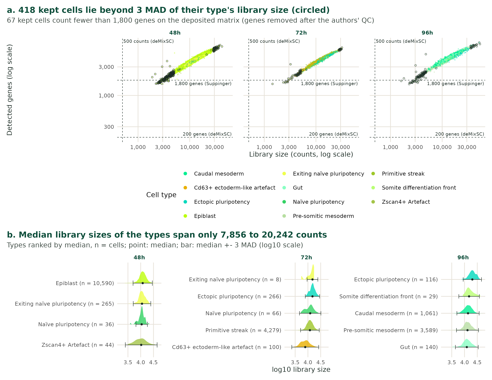
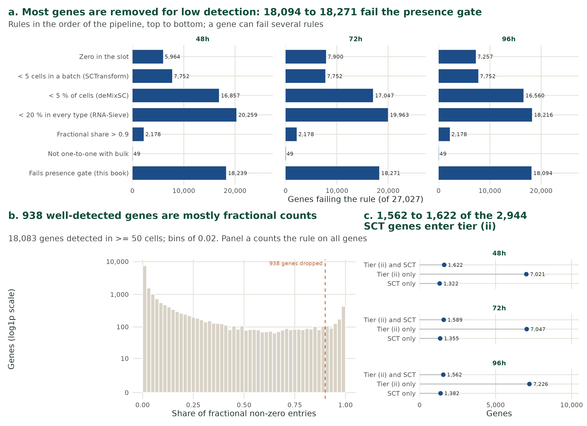
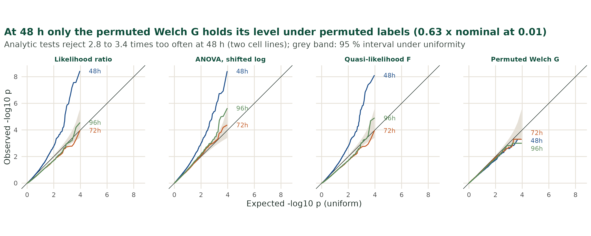
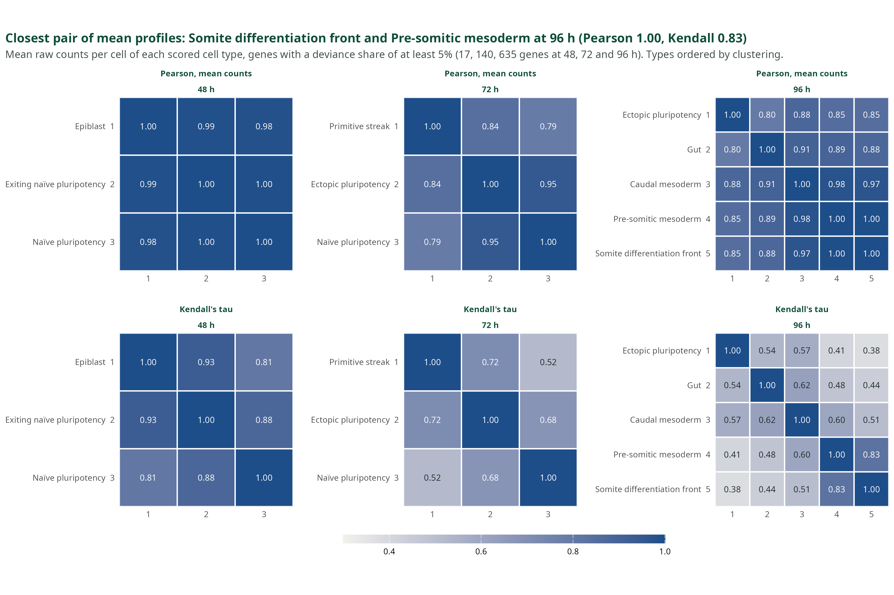
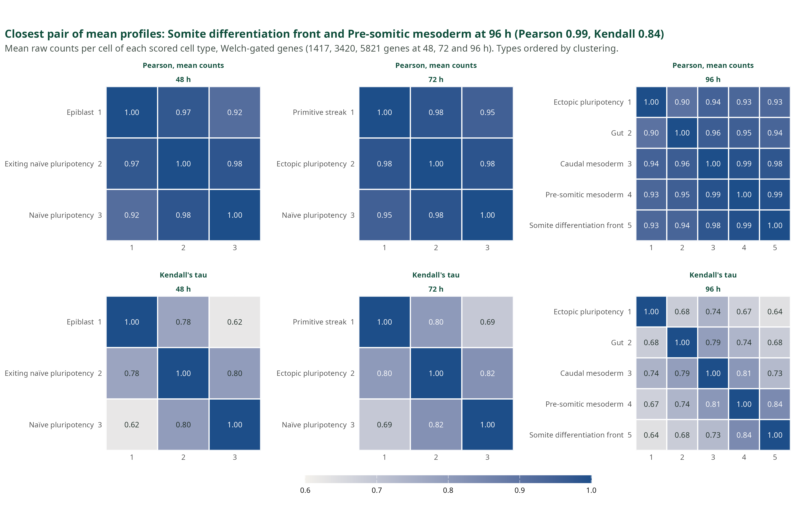
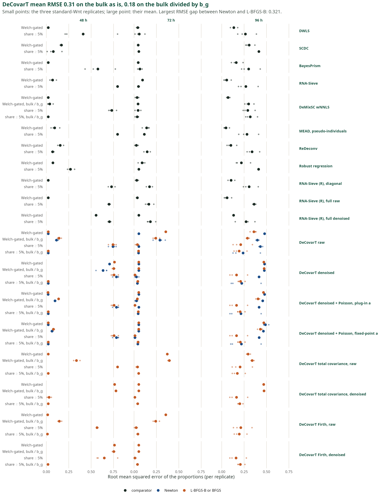
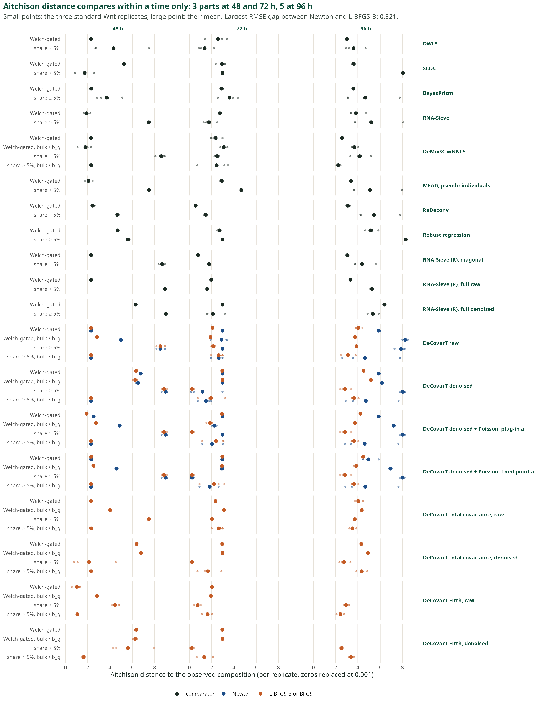

## Independent cells, shared noise, or one profile {.dag}

```{.tikz}
%%| filename: fig-cell-stories
%%| alt: Three graphical models. Independent cells of each type add to a bulk whose covariance is the sum of count times covariance. Equicorrelated cells share a type-level effect, and the covariance gains a factor one plus count minus one times rho. Population profiles are one draw per type scaled by the fraction, and the covariance carries the square of the fraction.
\begin{tikzpicture}
\begin{scope}
\node[ptitle] at (0,1.15) {(b) independent cells};
\node[const] (bm) at (0,0) {$m_j$};
\node[const] (bth) at (2.3,0) {$\boldsymbol{\mu}_{\cdot j},\boldsymbol{\Sigma}_j$};
\node[stoch] (bx) at (1.15,-1.9) {$\boldsymbol{X}_{jc}$};
\plate{bc}{(bx)}{$c\le m_j$}
\plate{bj}{(bm)(bth)(bc)(bc-lab)}{$j=1,\ldots,J$}
\node[det] (by) at (1.15,-5.0) {$\boldsymbol{y}$};
\node[note, below=1mm of by] {$\sum_j m_j\boldsymbol{\Sigma}_j$};
\draw[edge] (bm) -- (bx);
\draw[edge] (bth) -- (bx);
\draw[edge] (bj.south -| by) -- (by);
\end{scope}
\begin{scope}[xshift=68mm]
\node[ptitle] at (0,1.15) {(c) equicorrelated cells};
\node[const] (cm) at (0,0) {$m_j$};
\node[const] (cth) at (2.5,0) {$\boldsymbol{\mu}_{\cdot j},\boldsymbol{\Sigma}_j,\varrho_j$};
\node[stoch] (cB) at (2.5,-1.7) {$\boldsymbol{B}_j$};
\node[stoch] (cx) at (1.15,-3.3) {$\boldsymbol{X}_{jc}$};
\plate{cc}{(cx)}{$c\le m_j$}
\plate{cj}{(cm)(cth)(cB)(cc)(cc-lab)}{$j=1,\ldots,J$}
\node[det] (cy) at (1.15,-6.2) {$\boldsymbol{y}$};
\node[note, below=1mm of cy] {$\sum_j m_j[1+(m_j-1)\varrho_j]\boldsymbol{\Sigma}_j$};
\draw[edge] (cth) -- (cB);
\draw[edge] (cB) -- (cx);
\draw[edge] (cm) -- (cx);
\draw[edge] (cj.south -| cy) -- (cy);
\end{scope}
\begin{scope}[xshift=138mm]
\node[ptitle] at (0,1.15) {(d) population profiles};
\node[const] (dp) at (0,0) {$p_j$};
\node[const] (dth) at (2.3,0) {$\boldsymbol{\mu}_{\cdot j},\boldsymbol{\Sigma}_j$};
\node[stoch] (dZ) at (2.3,-1.9) {$\boldsymbol{Z}_j$};
\plate{dj}{(dp)(dth)(dZ)}{$j=1,\ldots,J$}
\node[det] (dy) at (1.15,-5.0) {$\boldsymbol{y}$};
\node[note, below=1mm of dy] {$\sum_j p_j^{2}\boldsymbol{\Sigma}_j$};
\draw[edge] (dth) -- (dZ);
\draw[edge] (dZ) -- (dy);
\draw[edge] (dp) -- (dy);
\end{scope}
\end{tikzpicture}
```

[Panel (a), a mixture with a random cell label, is omitted. One specimen weights a covariance by a count or a fraction. A population profile puts a square on the fraction.]{.credit}

::: {.notes}
**Mathematics.** The three pictures are the vignette's panels (b), (c) and (d). A sum of K cells of one type has covariance KΣ plus the sum of the cross-covariances between cells. With a common correlation ϱ between two cells, that is K[1 + (K − 1)ϱ]Σ. At ϱ = 0 the weight is the count m (panel b). At ϱ = 1 it is m², the square of panel (d) once the bulk is divided by n. With a random effect per specimen, the same sum reads m Σ_W + m² Σ_B: within-specimen covariance takes the linear weight, between-specimen covariance the square.

**Biology.** Suppinger gives one single-cell specimen per time: 48 h pools the two cell lines, 72 h is one line, 96 h the other. One specimen cannot estimate Σ_B, so the linear weight is the one with a sampling reading here.

**Say.** The released DeCovarT used the square. The reference we have only supports the linear weight.
:::

## A square weight shrinks the rare type's contribution {.explorer}

```{ojs}
//| echo: false
mixLin = {
  const mat = (v1, v2, rho) => {
    const s1 = Math.sqrt(v1), s2 = Math.sqrt(v2);
    return [[v1, rho * s1 * s2], [rho * s1 * s2, v2]];
  };
  const add = (A, B, x, y) => [
    [x * A[0][0] + y * B[0][0], x * A[0][1] + y * B[0][1]],
    [x * A[1][0] + y * B[1][0], x * A[1][1] + y * B[1][1]]
  ];
  const det = (S) => S[0][0] * S[1][1] - S[0][1] * S[1][0];
  const inv = (S) => {
    const d = det(S);
    return [[S[1][1] / d, -S[0][1] / d], [-S[1][0] / d, S[0][0] / d]];
  };
  const quad = (r, Si) =>
    r[0] * (Si[0][0] * r[0] + Si[0][1] * r[1]) +
    r[1] * (Si[1][0] * r[0] + Si[1][1] * r[1]);
  const ring = (mean, S, k, n) => {
    const a = S[0][0], b = S[0][1], c = S[1][1];
    const tr = a + c;
    const disc = Math.sqrt(Math.max(0, tr * tr / 4 - det(S)));
    const l1 = Math.max(tr / 2 + disc, 0);
    const l2 = Math.max(tr / 2 - disc, 0);
    let v1x, v1y;
    if (Math.abs(b) < 1e-10 && Math.abs(a - c) < 1e-10) {
      v1x = 1; v1y = 0;
    } else if (Math.abs(b) < 1e-10) {
      v1x = a >= c ? 1 : 0;
      v1y = a >= c ? 0 : 1;
    } else {
      v1x = l1 - c; v1y = b;
    }
    const nrm = Math.hypot(v1x, v1y) || 1;
    v1x /= nrm; v1y /= nrm;
    const v2x = -v1y, v2y = v1x;
    const pts = [];
    for (let i = 0; i < n; i++) {
      const t = 2 * Math.PI * i / n;
      pts.push([
        mean[0] + k * Math.sqrt(l1) * Math.cos(t) * v1x + k * Math.sqrt(l2) * Math.sin(t) * v2x,
        mean[1] + k * Math.sqrt(l1) * Math.cos(t) * v1y + k * Math.sqrt(l2) * Math.sin(t) * v2y
      ]);
    }
    return pts;
  };
  const laws = (p, S1, S2) => ({
    Squad: add(S1, S2, p * p, (1 - p) * (1 - p)),
    Slin: add(S1, S2, p, 1 - p),
    quadParts: [add(S1, S2, p * p, 0), add(S1, S2, 0, (1 - p) * (1 - p))],
    linParts: [add(S1, S2, p, 0), add(S1, S2, 0, 1 - p)],
    SpQuad: add(S1, S2, 2 * p, -2 * (1 - p)),
    SpLin: add(S1, S2, 1, -1)
  });
  const fisher = (delta, S, Sp) => {
    const Si = inv(S);
    const mean = quad(delta, Si);
    const M = [
      [Si[0][0] * Sp[0][0] + Si[0][1] * Sp[1][0], Si[0][0] * Sp[0][1] + Si[0][1] * Sp[1][1]],
      [Si[1][0] * Sp[0][0] + Si[1][1] * Sp[1][0], Si[1][0] * Sp[0][1] + Si[1][1] * Sp[1][1]]
    ];
    const tr = M[0][0] * M[0][0] + M[1][1] * M[1][1] + 2 * M[0][1] * M[1][0];
    const I = mean + 0.5 * tr;
    return { I, half: 1.96 / Math.sqrt(Math.max(I, 1e-12)) };
  };
  const loglik = (y, mean, S) => {
    const Si = inv(S);
    const r = [y[0] - mean[0], y[1] - mean[1]];
    return -0.5 * (Math.log(Math.max(det(S), 1e-18)) + quad(r, Si));
  };
  const normal = (seed) => {
    let s = seed >>> 0;
    const rnd = () => {
      s = (1664525 * s + 1013904223) >>> 0;
      return s / 4294967296;
    };
    const u = Math.max(rnd(), 1e-12);
    return Math.sqrt(-2 * Math.log(u)) * Math.cos(2 * Math.PI * rnd());
  };
  return { mat, add, det, inv, ring, laws, fisher, loglik, normal };
}
```

```{ojs}
//| echo: false
viewof densCtrl = Inputs.form({
  v1: Inputs.range([1, 64], {value: 16, step: 1, label: "Variance, gene 1"}),
  v2: Inputs.range([1, 64], {value: 16, step: 1, label: "Variance, gene 2"}),
  rho: Inputs.range([-0.85, 0.85], {value: 0.6, step: 0.05, label: "Correlation, type 1"}),
  share: Inputs.range([0.02, 0.98], {value: 0.5, step: 0.01, label: "Share of type 1"})
})
```

```{ojs}
//| echo: false
densModel = {
  const p = densCtrl.share;
  const S1 = mixLin.mat(densCtrl.v1, densCtrl.v2, densCtrl.rho);
  const S2 = mixLin.mat(densCtrl.v1, densCtrl.v2, 0);
  const mu1 = [20, 22], mu2 = [22, 20];
  const mean = [p * mu1[0] + (1 - p) * mu2[0], p * mu1[1] + (1 - p) * mu2[1]];
  const { Squad, Slin, quadParts, linParts } = mixLin.laws(p, S1, S2);
  const pts = mixLin.ring(mean, Squad, 2, 48)
    .concat(mixLin.ring(mean, Slin, 2, 48), [mu1, mu2, mean]);
  const xs = pts.map((d) => d[0]), ys = pts.map((d) => d[1]);
  const xmin = Math.min(...xs), xmax = Math.max(...xs);
  const ymin = Math.min(...ys), ymax = Math.max(...ys);
  const H = p <= 0 || p >= 1 ? 0 : -p * Math.log2(p) - (1 - p) * Math.log2(1 - p);
  return {
    Squad, Slin, quadParts, linParts, mu1, mu2, mean, p, H,
    xdom: [xmin - 0.08 * (xmax - xmin || 1), xmax + 0.08 * (xmax - xmin || 1)],
    ydom: [ymin - 0.08 * (ymax - ymin || 1), ymax + 0.08 * (ymax - ymin || 1)]
  };
}
```

```{ojs}
//| echo: false
densNote = html`<span style="color:#5c6b63">Share of type 1 ${densModel.p.toFixed(2)}. Shannon entropy ${densModel.H.toFixed(2)} bits. One bit is an even mix.</span>`
```

```{ojs}
//| echo: false
// One panel: the two weighted type covariances (outlines, one standard
// deviation) and their sum, the bulk covariance (filled, one and two).
densPanel = (model, law) => {
  const quad = law === "quad";
  const sum = quad ? model.Squad : model.Slin;
  const parts = quad ? model.quadParts : model.linParts;
  const colour = quad ? "#c45c26" : "#1d4e89";
  const types = [
    { S: parts[0], colour: "#5c3d7a", mu: model.mu1, label: quad ? "Type 1: p² Σ₁" : "Type 1: p Σ₁" },
    { S: parts[1], colour: "#0e4d3a", mu: model.mu2, label: quad ? "Type 2: (1 − p)² Σ₂" : "Type 2: (1 − p) Σ₂" }
  ];
  const W = 460, H = 290, left = 44, right = 14, top = 44, bottom = 32;
  const x = d3.scaleLinear().domain(model.xdom).range([left, W - right]);
  const y = d3.scaleLinear().domain(model.ydom).range([H - bottom, top]);
  const svg = d3.create("svg").attr("viewBox", [0, 0, W, H]).attr("width", "100%")
    .style("font", "14px sans-serif");
  svg.append("g").attr("transform", `translate(${left},0)`).call(d3.axisLeft(y).ticks(4));
  svg.append("g").attr("transform", `translate(0,${H - bottom})`).call(d3.axisBottom(x).ticks(4));
  const line = d3.line().x((d) => x(d[0])).y((d) => y(d[1]));
  for (const k of [2, 1]) {
    svg.append("path")
      .attr("d", line(mixLin.ring(model.mean, sum, k, 64)) + "Z")
      .attr("fill", colour).attr("fill-opacity", k === 2 ? 0.12 : 0.25)
      .attr("stroke", colour);
  }
  for (const t of types) {
    svg.append("path")
      .attr("d", line(mixLin.ring(model.mean, t.S, 1, 64)) + "Z")
      .attr("fill", "none").attr("stroke", t.colour).attr("stroke-width", 2.5);
    svg.append("circle").attr("cx", x(t.mu[0])).attr("cy", y(t.mu[1])).attr("r", 5).attr("fill", t.colour);
  }
  svg.append("text").attr("x", left + 8).attr("y", 16).attr("fill", colour).attr("font-weight", 700)
    .text(quad ? "Population: square weights, sum filled" : "Single cell: linear weights, sum filled");
  const key = svg.append("text").attr("x", left + 8).attr("y", 34);
  key.append("tspan").attr("fill", types[0].colour).text(types[0].label);
  key.append("tspan").attr("fill", types[1].colour).attr("dx", 18).text(types[1].label);
  return svg.node();
}
```

::: {.columns}
::: {.column width="50%"}

```{ojs}
//| echo: false
densLeft = densPanel(densModel, "quad")
```

:::
::: {.column width="50%"}

```{ojs}
//| echo: false
densRight = densPanel(densModel, "lin")
```

:::
:::

[Outlines: the weighted covariance of each type, at one standard deviation, drawn around the bulk mean. Filled: their sum, the covariance of the bulk, at one and two standard deviations. Covariances add because the bulk is a sum of independent draws; the picture is not a mixture density. Dots: the type means, (20, 22) in purple and (22, 20) in green. Type 2 correlation is held at 0. Both panels share the axes.]{.credit}

::: {.notes}
**Mathematics.** The bulk is a sum of independent contributions, so its covariance is the sum of the weighted type covariances: p² Σ₁ + (1 − p)² Σ₂ for population profiles, p Σ₁ + (1 − p) Σ₂ for cells of one specimen. Move the share to 0.05. The weight of type 1 is 0.0025 under the square and 0.05 under the linear law, twenty times more. The square weights sum to p² + (1 − p)², which is 0.5 at an even mix, so the filled ellipse on the left is the smaller one there. The linear weights always sum to 1.

**Biology.** The somite differentiation front has 29 of the 4,935 reference cells at 96 h, a share of 0.006. Its square is 0.00003. Under the square law the covariance of a rare type has almost no say in the likelihood.

**Say.** Watch the purple outline. On the left it vanishes well before the type does.
:::

## The square weight is not the wider interval {.explorer}

```{ojs}
//| echo: false
viewof ciCtrl = Inputs.form({
  v1: Inputs.range([1, 64], {value: 16, step: 1, label: "Variance, gene 1"}),
  v2: Inputs.range([1, 64], {value: 16, step: 1, label: "Variance, gene 2"}),
  rho: Inputs.range([-0.85, 0.85], {value: 0.6, step: 0.05, label: "Correlation, type 1"}),
  share: Inputs.range([0.02, 0.98], {value: 0.05, step: 0.01, label: "True share of type 1"})
})
```

```{ojs}
//| echo: false
viewof ciDraw = Inputs.button("Draw one bulk from the linear law")
```

```{ojs}
//| echo: false
ciChart = {
  const p0 = ciCtrl.share;
  const mu1 = [20, 22], mu2 = [22, 20];
  const delta = [mu1[0] - mu2[0], mu1[1] - mu2[1]];
  const meanOf = (p) => [p * mu1[0] + (1 - p) * mu2[0], p * mu1[1] + (1 - p) * mu2[1]];
  const S1 = mixLin.mat(ciCtrl.v1, ciCtrl.v2, ciCtrl.rho);
  const S2 = mixLin.mat(ciCtrl.v1, ciCtrl.v2, 0);
  const at = (p) => mixLin.laws(p, S1, S2);
  const base = at(p0);
  const mean0 = meanOf(p0);
  let y = mean0;
  if (ciDraw) {
    const z1 = mixLin.normal(20261112 + 2 * ciDraw);
    const z2 = mixLin.normal(20261112 + 2 * ciDraw + 1);
    const L00 = Math.sqrt(Math.max(base.Slin[0][0], 1e-12));
    const L10 = base.Slin[1][0] / L00;
    const L11 = Math.sqrt(Math.max(base.Slin[1][1] - L10 * L10, 1e-12));
    y = [mean0[0] + L00 * z1, mean0[1] + L10 * z1 + L11 * z2];
  }
  const fq = mixLin.fisher(delta, base.Squad, base.SpQuad);
  const fl = mixLin.fisher(delta, base.Slin, base.SpLin);
  const grid = d3.range(0.02, 0.981, 0.01);
  const series = [
    { name: "Population", colour: "#c45c26", half: fq.half, cov: (p) => at(p).Squad },
    { name: "Single cell", colour: "#1d4e89", half: fl.half, cov: (p) => at(p).Slin }
  ];
  for (const s of series) {
    s.ll = grid.map((p) => mixLin.loglik(y, meanOf(p), s.cov(p)));
    s.max = Math.max(...s.ll);
  }
  const W = 980, H = 250, mid = 500;
  const svg = d3.create("svg").attr("viewBox", [0, 0, W, H]).attr("width", "100%")
    .style("font", "14px sans-serif");
  const xShare = d3.scaleLinear().domain([0, 1]).range([48, mid - 24]);
  svg.append("text").attr("x", 48).attr("y", 16).attr("fill", "#1c2b24").attr("font-weight", 700)
    .text("Wald interval for the true share");
  svg.append("line").attr("x1", xShare(0)).attr("x2", xShare(1)).attr("y1", 108).attr("y2", 108)
    .attr("stroke", "#cfc6b8");
  svg.append("line").attr("x1", xShare(p0)).attr("x2", xShare(p0)).attr("y1", 36).attr("y2", 168)
    .attr("stroke", "#1c2b24").attr("stroke-dasharray", "4 3");
  series.forEach((s, i) => {
    const y0 = 78 + i * 48;
    const lo = Math.max(0, p0 - s.half), hi = Math.min(1, p0 + s.half);
    svg.append("line").attr("x1", xShare(lo)).attr("x2", xShare(hi)).attr("y1", y0).attr("y2", y0)
      .attr("stroke", s.colour).attr("stroke-width", 8).attr("stroke-linecap", "round");
    svg.append("circle").attr("cx", xShare(p0)).attr("cy", y0).attr("r", 4).attr("fill", "#1c2b24");
    svg.append("text").attr("x", 48).attr("y", y0 - 12).attr("fill", s.colour)
      .text(`${s.name}: half-width ${s.half.toFixed(2)}`);
  });
  svg.append("text").attr("x", 48).attr("y", 200).attr("fill", "#5c6b63")
    .text("Dashed line: true share. Bars are clipped to [0, 1].");
  const xP = d3.scaleLinear().domain([0.02, 0.98]).range([mid + 36, W - 16]);
  const lls = series.flatMap((s) => s.ll);
  const cuts = series.map((s) => s.max - 1.92);
  const yL = d3.scaleLinear()
    .domain([Math.min(...lls, ...cuts), Math.max(...lls)])
    .range([H - 36, 28])
    .nice();
  svg.append("text").attr("x", mid + 36).attr("y", 16).attr("fill", "#1c2b24").attr("font-weight", 700)
    .text(ciDraw ? "Log-likelihood of the drawn bulk" : "Log-likelihood at the mean bulk");
  svg.append("g").attr("transform", `translate(${mid + 36},0)`).call(d3.axisLeft(yL).ticks(4));
  svg.append("g").attr("transform", `translate(0,${H - 36})`).call(d3.axisBottom(xP).ticks(5));
  const panel = svg.append("g").attr("clip-path", "url(#ll-clip)");
  svg.append("clipPath").attr("id", "ll-clip").append("rect")
    .attr("x", mid + 8).attr("y", 20).attr("width", W - mid - 8).attr("height", H - 56);
  const line = d3.line().x((d, i) => xP(grid[i])).y((d) => yL(d));
  for (const s of series) {
    panel.append("path").attr("d", line(s.ll)).attr("fill", "none")
      .attr("stroke", s.colour).attr("stroke-width", 2);
    const cut = s.max - 1.92;
    panel.append("line").attr("x1", xP(0.02)).attr("x2", xP(0.98))
      .attr("y1", yL(cut)).attr("y2", yL(cut))
      .attr("stroke", s.colour).attr("stroke-dasharray", "3 3").attr("opacity", 0.85);
  }
  return svg.node();
}
```

[Expected Fisher information of one Gaussian bulk: the mean contrast $\delta=\mu_1-\mu_2$, plus half the trace of $\Sigma^{-1}\Sigma'\Sigma^{-1}\Sigma'$. Opening setting, checked separately: variances 16, correlation 0.6 against 0, share 0.05, half-widths 0.92 (square) and 2.09 (linear). The square weight is tighter because $p^2+(1-p)^2$ still moves. The dashed lines on the right are the likelihood-ratio cuts, 1.92 below each maximum, which is 3.84 on the deviance scale.]{.credit}

::: {.notes}
**Mathematics.** For one Gaussian bulk with mean μ(p) and covariance Σ(p), the expected information on p is δᵀ Σ⁻¹ δ + ½ tr(Σ⁻¹ Σ′ Σ⁻¹ Σ′). The derivative Σ′ is 2p Σ₁ − 2(1 − p) Σ₂ under the square law and Σ₁ − Σ₂ under the linear law. The rare type's own piece, 2p Σ₁, vanishes as p falls. The curvature that remains is the scale of the abundant type. Under the linear law, two types with equal covariances give Σ′ = 0, and only the mean informs.

**Caution.** Do not tell the room that a low share makes the population interval wider: at the opening setting it is the narrower one. Both half-widths, 0.92 and 2.09, exceed the simplex. One bulk of two genes says little, and the comparison is between the two laws.

**Say.** The square weight is not a loss of information. It is a different model, and the reference does not support it.
:::

## Symbols for the averaged mixture {.dense}

| Symbol | Meaning on the next two slides |
|---|---|
| $p_{ji}$ | Cell fraction of type $j$ in bulk $i$ |
| $n_i$ | Number of cells behind that bulk |
| $a_i$ | Capture ratio from the reference to the bulk |
| $c_i = a_i n_i$ | Scale of the mean |
| $\phi_i = a_i^2 n_i$ | Scale of the within-type covariance |
| $\boldsymbol{S}_W(\boldsymbol{p}) = \sum_j p_j \boldsymbol{\Sigma}_{W,j}$ | Linear mixture of within-type covariances |
| $\boldsymbol{D}_i$ | Diagonal noise added by the bulk |

[Per-cell means wear a tilde. $\boldsymbol{\Sigma}_{W,j}$ is the cell-to-cell covariance of one specimen.]{.credit}

::: {.notes}
**Mathematics.** The two scales are products of the same two unknowns. Given c and φ, the cell count is n = c² / φ and the capture ratio is a = φ / c. The mixture S_W is linear in p because the cells of one specimen are taken as independent draws.

**Say.** Keep c and φ in mind: these are the two quantities the best fit estimates, and the only two.
:::

## Three layers, from a missing count to a diagonal {.layers}

::: {.columns}
::: {.column width="33%"}

### The per-cell average

$$\tilde{\boldsymbol{y}}\mid\boldsymbol{p},n\sim\mathcal{N}\!\left(\tilde{\boldsymbol{\mu}}\boldsymbol{p},\,n^{-1}\boldsymbol{S}_W(\boldsymbol{p})\right)$$

$n$ is missing. It can come from the covariance magnitude, from a paired bulk, or from an external count.

:::
::: {.column width="33%"}

### Two scales

$$\boldsymbol{y}\mid\boldsymbol{p},a,n\sim\mathcal{N}\!\left(c\,\tilde{\boldsymbol{\mu}}\boldsymbol{p},\,\phi\,\boldsymbol{S}_W(\boldsymbol{p})\right)$$

$$c = an,\qquad \phi = a^{2}n$$

The simplex lets the mean pin $c$. $\phi$ is what is left in the covariance.

:::
::: {.column width="34%"}

### A diagonal the bulk adds

$$\boldsymbol{\Sigma}=\phi\,\boldsymbol{S}_W(\boldsymbol{p})+\boldsymbol{D}$$

The off-diagonal entries pin $\phi$. The diagonal excess is $\boldsymbol{D}$.

The raw $\boldsymbol{\Sigma}_{W,j}$ matches the bulk only at capture ratio 1. Otherwise the bulk adds its own diagonal.

:::
:::

::: {.notes}
**Mathematics.** A bulk of n cells, each captured at ratio a, has a mean that grows like a n and a variance that grows like a² n. The simplex constraint lets the mean fix c. The off-diagonal entries of the covariance then fix φ, and what the diagonal has in excess is D. With a between-specimen term the full covariance reads c² S_B + φ S_W + D; the reference cannot estimate S_B.

**Biology.** The bulk comes without a cell count. The raw single-cell covariance matches the bulk only at capture ratio 1, and the bulk and its own reference mixture correlate at 0.48 to 0.83 on the log scale.

**Say.** Three layers, each added because the previous one left something unexplained.
:::

## Capture and depth are different powers of $a$ {.explorer}

```{ojs}
//| echo: false
viewof scaleCtrl = Inputs.form({
  a: Inputs.range([-1.3, 0.7], {value: 0, step: 0.05, label: "log10 capture a"}),
  n: Inputs.range([1, 4], {value: 2, step: 0.05, label: "log10 cell count n"}),
  tau: Inputs.range([0, 6], {value: 2, step: 0.1, label: "log10 diagonal variance"})
})
```

::: {.columns}
::: {.column width="58%"}

```{ojs}
//| echo: false
scaleCloud = {
  const a = 10 ** scaleCtrl.a;
  const n = 10 ** scaleCtrl.n;
  const tau2 = 10 ** scaleCtrl.tau;
  const p = 0.35;
  const c = a * n, phi = a * a * n;
  const S1 = mixLin.mat(16, 16, 0.5);
  const S2 = mixLin.mat(16, 16, 0);
  const Sw = mixLin.add(S1, S2, p, 1 - p);
  const S = mixLin.add(Sw, [[1, 0], [0, 1]], phi, tau2);
  const Sbio = mixLin.add(Sw, [[0, 0], [0, 0]], phi, 0);
  const mean = [0, 0];
  const pts = mixLin.ring(mean, S, 2, 64);
  const xs = pts.map((d) => d[0]), ys = pts.map((d) => d[1]);
  const lim = Math.max(Math.abs(Math.min(...xs)), Math.abs(Math.max(...xs)), Math.abs(Math.min(...ys)), Math.abs(Math.max(...ys)), 1) * 1.15;
  const W = 520, H = 280, m = 36;
  const x = d3.scaleLinear().domain([-lim, lim]).range([m, W - 8]);
  const y = d3.scaleLinear().domain([-lim, lim]).range([H - 28, 22]);
  const svg = d3.create("svg").attr("viewBox", [0, 0, W, H]).attr("width", "100%").style("font", "14px sans-serif");
  const line = d3.line().x((d) => x(d[0])).y((d) => y(d[1]));
  svg.append("path").attr("d", line(mixLin.ring(mean, Sbio, 2, 64)) + "Z")
    .attr("fill", "#1d4e89").attr("fill-opacity", 0.25).attr("stroke", "#1d4e89");
  svg.append("path").attr("d", line(pts) + "Z")
    .attr("fill", "none").attr("stroke", "#c45c26").attr("stroke-width", 2);
  svg.append("text").attr("x", m).attr("y", 16).attr("fill", "#1c2b24")
    .text("Blue: φ S_W only. Orange: plus the diagonal.");
  return svg.node();
}
```

:::
::: {.column width="42%"}

```{ojs}
//| echo: false
scaleRead = {
  const a = 10 ** scaleCtrl.a;
  const n = 10 ** scaleCtrl.n;
  const tau2 = 10 ** scaleCtrl.tau;
  const p = 0.35;
  const c = a * n, phi = a * a * n;
  const S1 = mixLin.mat(16, 16, 0.5);
  const S2 = mixLin.mat(16, 16, 0);
  const sw = p * S1[0][0] + (1 - p) * S2[0][0];
  const bio = phi * sw;
  const share = tau2 / (bio + tau2);
  const nNaive = n * (1 - share);
  const box = (label, value) => `<div style="margin:0.15em 0"><span style="color:#5c6b63">${label}</span><br><b style="font-size:22px;color:#0e4d3a">${value}</b></div>`;
  return html`<div style="font-size:15px;line-height:1.25">${box("Mean scale c = a n", c.toPrecision(3))}${box("Variance scale φ = a² n", phi.toPrecision(3))}${box("Diagonal share, gene 1", (100 * share).toFixed(0) + "%")}${box("n read if the diagonal is ignored", nNaive.toPrecision(3))}</div>`;
}
```

:::
:::

[Share of type 1 fixed at 0.35. Variances 16. Type 1 correlation 0.5, type 2 correlation 0. When the diagonal dominates, the covariance no longer returns $n$. This is the linear-weight law of the raw-covariance fits.]{.credit}

::: {.notes}
**Mathematics.** At the opening setting a = 1 and n = 100, so c = φ = 100. Lower the capture by a factor ten: c falls by ten, φ by a hundred. The share of the diagonal in the variance of gene 1 is the diagonal variance over φ s_W plus the diagonal variance. A fit that ignores the diagonal reads n times one minus that share.

**Biology.** On Suppinger the fitted φ is 10⁶ to 10⁸ and the implied cell count c² / φ is below one cell. The covariance magnitude does not return a plausible n, which is why n is not reported.

**Say.** The variance scale absorbs everything the bulk adds. It is a nuisance scale, not a cell count.
:::

## The best fit profiles out two scales and nothing else {.dense}

| Technical factor | In the raw-covariance fit at $\lambda = 0.5$ |
|---|---|
| Mean scale $c$ | Used. Profiled out in closed form |
| Variance scale $\phi$ | Used. Profiled out in closed form; fitted values $10^{6}$ to $10^{8}$ |
| Cell count $n$ and capture $a$, separately | Not fitted. $\hat n = c^{2}/\phi$ is below one cell |
| Diagonal $\boldsymbol{D}$ | Not used. A gene-wise variance scale did not converge in 13 of 18 chains |
| Gene scale $b_g$ on the bulk | Not used. It helps on the small panels and hurts on the Welch panel at 96 h |
| Library-size normalisation | None. Raw counts on both sides |

[The covariance plug-in is the raw covariance of each type, with its off-diagonal terms multiplied to reach $\lambda = 0.5$; variances are untouched. Of the three layers, the fit keeps the second.]{.credit}

::: {.notes}
**Mathematics.** With c and φ free, both have a closed form given p, and the likelihood is profiled over them. The quadratic form then enters through its logarithm, and its gradient is the fixed-scale gradient divided by the fitted φ. That is how a φ of 10⁶ to 10⁸ makes the mean term and the log-determinant comparable.

**What was tried and dropped.** The gene-wise variance scale had no consistent effect and its alternation did not converge in 13 of 18 chains. Dividing the bulk by the gene scale gives a mean RMSE of 0.18 against 0.31 over the figure, but hurts on the Welch panel at 96 h. The between-type covariance term gives 0.30 against 0.36, with no pattern over the 24 cells of the design. The Firth penalty changes the estimates at the third decimal on the Welch panel at 72 h.

**Say.** The winning row is the plainest model of the slide before: two scales, raw counts, and a covariance shrunk half-way.
:::

## The authors' cell filters stand {.qc}

::: {.columns}
::: {.column width="50%"}

{group="qc"}

:::
::: {.column width="50%"}

{group="qc"}

:::
:::

[Cells kept above 1,800 genes and below 10% mitochondrial counts stay kept. The book drops genes whose non-zero entries are more than 90% fractional, and keeps a gene only if it is seen in at least 5% of the cells of every scored type.]{.credit}

::: {.notes}
**Biology.** The authors kept cells with more than 1,800 detected genes and less than 10% mitochondrial counts. Both cut-offs are stricter than the examples of the deconvolution literature (200 genes, 50%), so no rule of that literature removes a cell they kept. In the deposited counts, 65 of the 20,437 scored cells sit at or below 1,800 genes, with a minimum of 1,548. The mitochondrial share cannot be recomputed: no mitochondrial gene is deposited. The book applies no new cell filter.

**Genes.** Salmon/Alevin splits multi-mapping molecules, so 12.8% of the non-zero entries are fractional. Genes with more than 90% fractional entries are dropped. The presence gate asks for 5% of the cells of every scored type, because a gene absent from one type has no variance to estimate there.

**Say.** We did not re-filter the cells. We filtered genes, for reasons the covariance needs.
:::

## Three of the four tests assume independent cells {.dense}

| Test | Reference law | What has to be true |
|---|---|---|
| Likelihood ratio | $\chi^2_{J-1}$ on the deviance | Negative-binomial mean and dispersion, dispersion treated as known, independent cells |
| ANOVA on the shifted log | $F_{J-1,\,C-J}$ | Independent normal cells after $\log(x/s+y_0)$ |
| Quasi-likelihood $F$ | $F$, dispersion estimated | Extra-Poisson variance is allowed; cells are still independent |
| Permuted Welch $G$ | Freedman–Lane label permutation | Residuals of the null model are exchangeable within batch; type variances may differ |

[The first three refer a sum of squares, or a deviance, to a table that independence justifies. Only the permutation uses the residual cloud.]{.credit}

::: {.notes}
**Mathematics.** J is the number of types and C the number of cells. The first three tests compare a statistic with a tabulated law, and that law holds only if cells are independent given their type. The permuted Welch G follows Freedman and Lane: fit the null model, permute its residuals within batch, refit, and read the p-value from the permuted statistics. It asks for exchangeable residuals within a batch, and allows one variance per type.

**Agreement.** Kendall's tau between the likelihood ratio and the quasi-likelihood F is 0.98 at every time. Between the permuted Welch G and the other three it is 0.68 to 0.80.

**Say.** Three tests share one assumption. The next slide shows the time point where it fails.
:::

## At 48 h the analytic tests read cell line as type {.qq}



[At the 0.01 level and at 48 h, the likelihood ratio rejects 2.9 times the nominal rate, the quasi-likelihood $F$ 2.8 times, and the shifted-log ANOVA 3.4 times. The permuted Welch $G$ rejects 0.63 times. A within-batch permutation keeps the cell-line shift, and the analytic tests do not model the cell line.]{.credit}

::: {.notes}
**Mathematics.** Labels are permuted once within batch, so no gene has a type effect, and the p-values should be uniform. A within-batch permutation keeps the association between type and cell line. A test that does not model the line reads its effect as a type effect.

**Biology.** 48 h is the only time with two cell lines: 5,647 cells of one and 5,288 of the other. At 72 h and 96 h, one line each, every test is at or below its nominal rate, except the ANOVA at 1.2 to 1.4 times. The permuted Welch G then passes 1,417, 3,420 and 5,821 genes at 48, 72 and 96 h, at a false discovery rate of 0.05. Of those, 99%, 96% and 89% explain less than 5% of the deviance. The genes above 5% form the small panel: 17, 140 and 635 genes.

**Say.** The gate is the permutation test. Most gated genes carry a real but small type effect.
:::

## Dispersion widens two intervals; correlation fools the within-cell ones {.explorer}

```{ojs}
//| echo: false
viewof forestCtrl = Inputs.form({
  phi: Inputs.range([1, 8], {value: 1, step: 0.5, label: "Dispersion φ"}),
  rho: Inputs.range([0, 0.7], {value: 0, step: 0.05, label: "Within-type correlation"})
})
```

```{ojs}
//| echo: false
viewof forestDraw = Inputs.button("Draw samples")
```

```{ojs}
//| echo: false
forestChart = {
  const phi = forestCtrl.phi, rho = forestCtrl.rho;
  const n1 = 40, n2 = 10, ratio = 4, s0 = 20, delta = 1, mu1 = 20, mu2 = 21;
  const m1 = phi * s0, m2 = ratio * m1;
  const v1 = m1 * (1 - rho), v2 = m2 * (1 - rho);
  const trueSe = Math.sqrt(
    m1 * (1 + (n1 - 1) * rho) / n1 + m2 * (1 + (n2 - 1) * rho) / n2
  );
  const poisSe = Math.sqrt(mu1 / n1 + mu2 / n2);
  const sp2 = ((n1 - 1) * v1 + (n2 - 1) * v2) / (n1 + n2 - 2);
  const rows = [
    { name: "Likelihood ratio", se: Math.sqrt(s0 / n1 + s0 / n2), colour: "#5c3d7a" },
    { name: "ANOVA, pooled", se: Math.sqrt(sp2 * (1 / n1 + 1 / n2)), colour: "#c45c26" },
    { name: "Quasi-likelihood", se: Math.sqrt(phi) * poisSe, colour: "#1d4e89" },
    { name: "Welch, within type", se: Math.sqrt(v1 / n1 + v2 / n2), colour: "#0e4d3a" }
  ];
  const Phi = (z) => {
    const t = 1 / (1 + 0.2316419 * Math.abs(z));
    const d = 0.3989422804 * Math.exp(-0.5 * z * z);
    const p = d * t * (0.319381530 + t * (-0.356563782 + t * (1.781477937 + t * (-1.821255978 + t * 1.330274429))));
    return z >= 0 ? 1 - p : p;
  };
  const coverP = (se) => 2 * Phi(1.96 * se / trueSe) - 1;
  const draws = Math.max(forestDraw, 0);
  const hits = rows.map(() => 0);
  let dHat = delta;
  for (let b = 1; b <= Math.max(draws, 1); b++) {
    const z = mixLin.normal(20261112 + b);
    const centre = delta + trueSe * z;
    if (b === Math.max(draws, 1)) dHat = centre;
    if (draws > 0) {
      rows.forEach((r, i) => {
        if (Math.abs(centre - delta) <= 1.96 * r.se) hits[i] += 1;
      });
    }
  }
  const halfRange = Math.max(8, 1.96 * trueSe * 1.25);
  const W = 980, H = 250, left = 168, right = 150;
  const x = d3.scaleLinear().domain([delta - halfRange, delta + halfRange]).range([left, W - right]);
  const svg = d3.create("svg").attr("viewBox", [0, 0, W, H]).attr("width", "100%").style("font", "14px sans-serif");
  svg.append("line").attr("x1", x(delta)).attr("x2", x(delta)).attr("y1", 16).attr("y2", H - 28)
    .attr("stroke", "#1c2b24").attr("stroke-dasharray", "4 3");
  svg.append("line")
    .attr("x1", x(delta - 1.96 * trueSe)).attr("x2", x(Math.min(delta + halfRange, delta + 1.96 * trueSe)))
    .attr("y1", 28).attr("y2", 28).attr("stroke", "#cfc6b8").attr("stroke-width", 10);
  rows.forEach((r, i) => {
    const y = 62 + i * 42;
    const lo = dHat - 1.96 * r.se, hi = dHat + 1.96 * r.se;
    svg.append("line").attr("x1", x(lo)).attr("x2", x(hi)).attr("y1", y).attr("y2", y)
      .attr("stroke", r.colour).attr("stroke-width", 6).attr("stroke-linecap", "round");
    svg.append("circle").attr("cx", x(dHat)).attr("cy", y).attr("r", 4).attr("fill", r.colour);
    svg.append("text").attr("x", 8).attr("y", y + 4).attr("fill", r.colour).text(r.name);
    const tally = draws > 0 ? `, ${hits[i]}/${draws} draws` : "";
    svg.append("text").attr("x", W - 8).attr("y", y + 4).attr("text-anchor", "end").attr("fill", "#5c6b63")
      .text(`${(100 * coverP(r.se)).toFixed(0)}%${tally}`);
  });
  svg.append("text").attr("x", left).attr("y", H - 8).attr("fill", "#5c6b63")
    .text("Grey: true 95% interval. Dashed: true difference, 1.");
  return svg.node();
}
```

[A Gaussian sketch, not the Suppinger likelihoods. Forty cells and ten cells. Type 2's cell variance is four times type 1's, and $\varphi$ multiplies both. The likelihood-ratio interval uses a fixed variance. The quasi-likelihood interval multiplies the Poisson standard error by $\sqrt{\varphi}$. ANOVA and Welch use within-type variances, which shrink as the correlation grows, while the variance of the mean grows.]{.credit}

::: {.notes}
**Mathematics.** The mean of m equicorrelated cells has variance σ² [1 + (m − 1)ϱ] / m. The variance measured within the type is σ² (1 − ϱ). The first grows with ϱ and the second shrinks, so an interval built from within-type variances gets shorter while the truth gets wider. At φ = 1 and correlation 0, Welch matches the true interval and the other three are short, because they miss the four-fold variance ratio or the Poisson mean. Raise φ: the quasi-likelihood interval widens and the likelihood-ratio interval does not.

**Biology.** Shared culture, cell line and capture make cells of one type correlated. This is the mechanism behind the previous slide, in a two-group sketch.

**Say.** The percentage on the right is the coverage each interval really has. Nominal is 95.
:::

## A covariance entry is a property of the gene pair

- Deleting a gene leaves the other covariance entries as they were. A precision entry is a Schur complement of the panel, so it changes when a neighbour is removed.
- The likelihood inverts a sum of type covariances. That sum is dense even when every type precision is sparse.
- Shrinkage spends variance against bias. The sparse precision estimators stay in the benchmark as sensitivity analyses, not as the plug-in.

::: {.notes}
**Mathematics.** The covariance of genes g and g′ depends on those two genes only. The precision entry is the partial covariance given every other gene of the panel, so removing one gene changes it. The likelihood needs the inverse of Σ_j p_j Σ_j. The inverse of a sum is not the sum of the inverses: sparse type precisions do not give a sparse bulk precision.

**Biology.** The panel changes with the time and the gate, from 17 to 5,821 genes. A plug-in that does not depend on the panel can be estimated once and subset.

**Say.** We estimate covariances, shrink them, and invert only the mixture.
:::

## The closed form minimises the wrong risk {.dense}

$$\hat\Sigma_{gg} = V_{gg},\qquad \hat\Sigma_{gg'} = (1-\lambda)\,R_{gg'}\sqrt{V_{gg}V_{g'g'}}$$

The closed form of $\lambda$ minimises a Frobenius risk. DeCovarT evaluates a Gaussian likelihood. The tuning criterion is the mean Gaussian log-density of held-out cells of the same specimen, $K$ folds, the same score for every covariance estimator.

- Welch panel, 96 h, mean over three standard-Wnt replicates: raw covariance at $\lambda = 0.5$ has RMSE 0.034. The closed-form $\lambda$ has RMSE 0.36.
- $\lambda = 0.5$ is the best of four levels scored on those same nine samples. The 0.034 is optimistic until a level is chosen without the observed composition.

::: {.notes}
**Mathematics.** The estimator keeps the variances V and multiplies the correlations R by 1 − λ. The closed form picks λ to minimise the expected squared distance to the true covariance. That risk treats every entry alike. The Gaussian likelihood depends on the inverse and the determinant, which the smallest eigenvalues drive.

**Biology.** The closed-form λ of the types ranges from 0.006 to 0.74. On the Welch panel at 96 h the RMSE along λ is 0.36 at the closed form, 0.19 at 0.25, 0.034 at 0.5, 0.067 at 0.75 and 0.16 at 1, where only variances remain. The optimum is interior: correlations help, at half their sample value. At 72 h the best level is 0.25, with 0.033. The small panels show no gain.

**Caution.** The level was read on the nine samples that score it. Held-out cells of the same specimen give a criterion that never sees the observed composition.

**Say.** One number, λ, moves the error tenfold.
:::

## On the smallest panel, the three mesoderm profiles correlate at 0.97 and above {.corr}

{group="corr"}

[Genes whose type effect explains at least 5% of the deviance: 17, 140 and 635 genes at 48, 72 and 96 h. Top row: Pearson correlation of the mean raw counts per cell, the scale the solvers see. Bottom row: Kendall's tau. Types are ordered by clustering. At 96 h: caudal against pre-somitic mesoderm 0.98, caudal against somite front 0.97, pre-somitic against somite front 1.00.]{.credit}

::: {.notes}
**Mathematics.** Deconvolution regresses the bulk on the mean profiles. Two profiles with a Pearson correlation of 0.98 are nearly the same regressor: the fit can exchange their shares at almost no cost in residual.

**Biology.** This is the panel chosen for the largest type effects, and it still does not separate neighbours. At 48 h the three pluripotency states correlate at 0.98 to 1.00 on 17 genes. At 96 h, caudal mesoderm, pre-somitic mesoderm and the somite differentiation front are three steps of one lineage, at 0.97 to 1.00. Gut and ectopic pluripotency stand apart, at 0.80 to 0.91. Kendall's tau is much lower, 0.51 to 0.83 inside the lineage: the ranks differ, but a few highly expressed genes drive the Pearson correlation on raw counts.

**Say.** The types that matter most at 96 h are the ones the means cannot tell apart.
:::

## On the Welch panel the mesoderm lineage stays at 0.98 to 0.99 {.corr .dense}

::: {.columns}
::: {.column width="60%"}

{group="corr"}

:::
::: {.column width="40%"}

- **Unweighted least squares fails.** On one 96 h sample, non-negative least squares gives 100% to caudal mesoderm, observed at 0.22, and nothing to pre-somitic mesoderm, observed at 0.73. With the full raw covariance as weight, the same programme returns 0.22 and 0.78.
- **A condition number is the wrong gene filter here.** It reads the mean signature only. Minimising it keeps the genes that separate distant lineages and drops those that split neighbours. This is an argument, not a measurement: no condition number was computed.

:::
:::

[Welch-gated genes: 1,417, 3,420 and 5,821 at 48, 72 and 96 h. The cosine similarity of the closest pair is 0.98 at 48 h and 72 h and 0.99 at 96 h.]{.credit}

::: {.notes}
**Mathematics.** Least squares with equal weights is not built for regressors this correlated. The residual is nearly flat along the direction that moves mass between two collinear profiles, so the constraint p ≥ 0 decides, and the solution lands on a vertex. Here the vertex is caudal mesoderm, which is not the most abundant type. Weighting by the diagonal of the raw covariance gives 0.41 and 0.59. Weighting by the full covariance gives 0.22 and 0.78, against 0.22 and 0.73 observed. On this panel the Mahalanobis separation of the two profiles is 3.5 times the diagonal one; on the small panel it is 0.22 times.

**Condition number.** DWLS chooses its genes to minimise the condition number of the signature. Benchmarks on immune and tumour references find better deconvolution at a lower condition number. In a differentiation series neighbours are nearly collinear by biology, and the genes that split them are few and weak. A rule on the means discards them. The measured indicator of this book is the cosine similarity of the closest pair, and the test of the argument is still to do.

**Biology.** More genes do not help the means: at 72 h and 96 h every pair is more correlated on the Welch panel than on the small one.

**Say.** The information that separates the lineage is in the covariance, not in the means.
:::

## Eight comparators, four ways to model the bulk {.dense .grouped}

```{r}
comparators <- data.frame(
  paradigm = c(
    rep("Weighted least squares, diagonal weights", 3),
    "Probabilistic, reference as a prior",
    rep("Univariate likelihood, genes independent", 2),
    "Multivariate estimating equation",
    "Baseline"
  ),
  method = c(
    "DWLS", "SCDC", "DeMixSC", "BayesPrism", "RNA-Sieve", "ReDeconv",
    "MEAD", "Robust regression"
  ),
  beyond = c(
    "Dampened weights, inverse squared fitted mean",
    "Clipped gene weights; one reference, so no ensemble",
    "Residual weights",
    "Multinomial bulk, Gibbs sampling",
    "Central-limit Gaussian bulk; variance linear in the cell count",
    "Transcriptome size kept; variance from a sum over cells",
    "Corrected for reference error; gene-gene dependence in the sandwich variance",
    "Huber weights on outlying genes"
  )
)
reactable::reactable(
  comparators,
  groupBy = "paradigm",
  defaultExpanded = TRUE,
  pagination = FALSE,
  sortable = FALSE,
  compact = TRUE,
  columns = list(
    paradigm = reactable::colDef(name = "Paradigm", minWidth = 250),
    method = reactable::colDef(name = "Method", minWidth = 110),
    beyond = reactable::colDef(name = "Beyond the mean signature", minWidth = 380)
  ),
  theme = reactable::reactableTheme(
    backgroundColor = "transparent",
    borderColor = "#cfc6b8",
    headerStyle = list(background = "#e7f0ea", color = "#0e4d3a")
  )
)
```

[Click a paradigm to fold its methods. DeCovarT is a multivariate likelihood: the covariance of the bulk depends on the composition.]{.credit}

::: {.notes}
**Mathematics.** Weighted least squares minimises Σ_g w_g (y_g − μ_g p)², one weight per gene: the weight matrix is diagonal, and the methods differ by how w_g is set. BayesPrism writes a multinomial law for the bulk counts and updates the reference by Gibbs sampling. RNA-Sieve and ReDeconv write a Gaussian law per gene from a central limit over cells, with a variance that depends on the composition, and take genes as independent. MEAD solves an estimating equation corrected for the error of the reference, and carries gene-gene dependence in its sandwich variance: the dependence enters the intervals, not the point estimate. DeCovarT puts the gene-gene covariance in the likelihood itself.

**Caution.** The placement of ReDeconv and of the robust regression is mine. The Python RNA-Sieve behaved as a weighted least squares in this benchmark: under the pinned solver its proportion update raises an error that the package catches.

**Say.** Read the table downwards: each group uses more of the second moment than the one above.
:::

## Same likelihood, and the plug-in decides the error {.dense}

| DeCovarT variant | Welch panel, 96 h, or what the figure states |
|---|---|
| Raw covariance, $\lambda = 0.5$, L-BFGS-B | RMSE 0.034. Best of the four levels, on the samples that score it |
| Raw covariance, closed-form $\lambda$ | RMSE 0.36 |
| Denoised covariance | RMSE 0.47 |
| Newton against L-BFGS-B | Largest RMSE gap on the figure: 0.321 |
| Bulk divided by the gene scale $b_g$ | The figure's own summary: mean RMSE 0.18, against 0.31 on the bulk as is |

[Blue on the next two figures is trust-region Newton. Orange is L-BFGS-B. Black is a comparator, or the quadratic programme of the multivariate RNA-Sieve.]{.credit}

::: {.notes}
**Mathematics.** Every row maximises the same profile likelihood over the composition. The rows differ by the covariance plug-in, the optimiser and the scaling of the bulk. The denoised covariance removes a Poisson term from the raw covariance; for a type with few cells it has low rank, so a vertex of the simplex has a much smaller determinant than a mixture, and the log-determinant pulls the estimate to a face.

**Biology.** With the denoised covariance, the error of 0.47 is a wrong split inside the mesoderm lineage: 0.01 for pre-somitic mesoderm against 0.77 observed.

**Say.** Same likelihood, same data: the error goes from 0.47 to 0.034 on the plug-in alone.
:::

## Root mean squared error, three replicates {.bench}

{group="bench"}

[Small points: the three standard-Wnt replicates. Large point: their mean. Rows are methods. Columns are the bulk times.]{.credit}

::: {.notes}
**Mathematics.** The RMSE is taken over the cell types of one sample, between the estimated shares and the shares observed in the single-cell reference of the same time. It weighs an error of 0.1 alike on a type at 0.7 and on a type at 0.03.

**Biology.** At 96 h on the Welch panel: DeCovarT at λ = 0.5 has 0.034, MEAD 0.048, RNA-Sieve 0.056, the quadratic programme on the raw plug-ins 0.060, DeMixSC 0.071. The methods differ mostly by the split of the mesoderm lineage: SCDC puts 0.26 of the lineage in pre-somitic mesoderm, DWLS 0.55, RNA-Sieve 0.68. Click the figure to enlarge it.

**Say.** Three replicates per time. Read the spread of the small points before the rank of the large ones.
:::

## Aitchison distance ranks the rare types {.bench}

{group="bench"}

[Compare methods inside one time only: 3 parts at 48 h and 72 h, 5 parts at 96 h. Zeros are replaced at 0.001 before the centred log-ratio. A rare type set to zero costs more here than a shift between two abundant types, so this is not a copy of the RMSE ranking.]{.credit}

::: {.notes}
**Mathematics.** The Aitchison distance is the Euclidean distance between centred log-ratios. It measures ratios of shares: estimating 0.001 for a type observed at 0.03 costs as much as estimating 0.03 for a type observed at 0.9. A share of zero has no logarithm, hence the replacement at 0.001. The distance grows with the number of parts, so 48 h and 72 h (3 parts) are not comparable with 96 h (5 parts).

**Biology.** Gut (140 cells), ectopic pluripotency (116) and the somite front (29) are the rare types at 96 h. A method that sets them to zero keeps a low RMSE and pays here.

**Say.** RMSE asks whether the large types are right. Aitchison asks whether the rare ones exist.
:::

## What this benchmark supports

- The penalty on the covariance moves the error more than the choice of optimiser: 0.36 against 0.034 at 96 h on the Welch panel.
- The fit is not missing the mode. Its likelihood beats the observed composition in all 36 cases.
- A quadratic programme on the same raw plug-ins reaches RMSE 0.060. The plug-in, not the solver, is the gap.
- Refining the mean profiles from one bulk raises the error to about 0.50.
- Summing caudal mesoderm, pre-somitic mesoderm and the somite front at 96 h puts twelve of thirteen methods at 0.04 or below.

[$\lambda = 0.5$ was chosen on the samples that define the error. A level chosen on held-out cells, without the observed composition, is still required before that row is compared with MEAD or RNA-Sieve.]{.credit}

::: {.notes}
**Mathematics.** "Not missing the mode": in all 36 fits the likelihood at the estimate is higher than at the observed composition. The optimiser found a better point of the likelihood than the truth, so the likelihood, through its plug-ins, is what misleads. The quadratic programme uses the same raw plug-ins with the covariance held fixed, and reaches 0.060.

**Biology.** Bulk and reference differ: their log-scale correlation is 0.48 to 0.83. Refitting the mean profiles from one bulk makes the profiles fit the bulk instead of the proportions. Once caudal mesoderm, pre-somitic mesoderm and the somite front are summed, twelve of thirteen methods are at 0.04 or below: the benchmark is hard because of one lineage.

**Say.** The model is not wrong in its form. Its inputs, and one lineage, carry the error.
:::

## Five directions, ranked by this evidence

1. **Choose the shrinkage level without the answer.** Score each level on pseudo-bulks of held-out cells. Compare one common level with one per type.
2. **Estimate the composition from the mean equation.** Keep the covariance as a weight, and take the variance from a jackknife over gene clusters.
3. **Treat close types as a lineage.** Fit the lineage first, then its split. This helps every method.
4. **Add a measurement layer between bulk and reference.** A mean–variance law per gene across bulks.
5. **Carry the precision of the reference.** Replicates or a delete-a-group jackknife, instead of refitting the reference from the bulk.

[Which direction matters most depends on the regime. Three indicators were measured: cosine similarity of the profiles, bulk-to-reference shift, cells per gene. Covariance changes between conditions cannot be measured, because the reference follows one protocol.]{.credit}

::: {.notes}
**1.** λ = 0.5 was read on the scored samples. Pseudo-bulks built from held-out cells have a known composition and never use the observed one.

**2.** The quadratic programme reaches 0.060 where the full likelihood, started from refined means, returns 0.47: the mean equation is the stable part. Leaving one gene out would give too narrow a variance, because genes are correlated; whole gene clusters must be left out.

**3.** After summing the lineage, twelve of thirteen methods are at 0.04 or below. This direction depends least on the estimator.

**4.** Evidence: correlation 0.48 to 0.83 between a bulk and its own reference mixture, an implied cell count below one, and Huber weights that take the diagonal programme from 0.105 to 0.039 at 96 h. One variance scale per gene did not work. The candidate is Var(y) = ω m + κ_g m², the marginal law of a Poisson log-normal model.

**5.** Refining the means from one bulk raised the error to about 0.50. The uncertainty of the reference should enter as a variance, not as free parameters.

**Say.** The first direction is the one owed before any claim against MEAD or RNA-Sieve.
:::

## Appendix: three optimisers for the same likelihood {.layers}

::: {.columns}
::: {.column width="33%"}

### Trust-region Newton

$$\Delta=\arg\max_{\lVert\Delta\rVert\le r}\;\nabla_{\boldsymbol{\rho}}\ell^{\top}\Delta+\tfrac12\Delta^{\top}\mathbf{H}_{\boldsymbol{\rho}}\Delta$$

- Needs the score and the Hessian in ILR coordinates.
- Every step stays inside the simplex.
- Few steps, each with a factorisation of the $G\times G$ covariance.
- Cannot reach a face: fell short by up to 7.4 log-likelihood units in the vignette's simulations.

:::
::: {.column width="33%"}

### L-BFGS-B

$$\boldsymbol{w}^{+}=\bigl[\boldsymbol{w}+\alpha\,\mathbf{B}\,\nabla_{\boldsymbol{w}}\ell\bigr]_{+},\qquad \boldsymbol{p}=\frac{\boldsymbol{w}}{\mathbf{1}^{\top}\boldsymbol{w}}$$

- Needs the score only. $\mathbf{B}$ is built from the last few gradients.
- The box $\boldsymbol{w}\ge 0$ gives $p_j=0$ exactly.
- Cheaper steps, more of them.
- Fell short by at most $8\times10^{-4}$ in the same simulations.

:::
::: {.column width="34%"}

### Marquardt–Levenberg

$$\Delta=\bigl(-\mathbf{H}_{\boldsymbol{\rho}}+\kappa\mathbf{I}\bigr)^{-1}\nabla_{\boldsymbol{\rho}}\ell$$

- Needs the score and the Hessian. The damping $\kappa\ge 0$ keeps the matrix positive definite.
- ILR coordinates, as Newton.
- Stops on the ratio of optimisation error to statistical error.
- On a plateau it halts nearer the barycentre than the face. Dropped from the figures.

:::
:::

[The three steps are the textbook forms; the vignette describes them in words. $\boldsymbol{\rho}$: ILR coordinates of $\boldsymbol{p}$. $r$: trust radius. $\alpha$: step length. $[\cdot]_{+}$: projection on $\boldsymbol{w}\ge 0$. On the benchmark figures, the largest RMSE gap between Newton and L-BFGS-B is 0.321.]{.credit}

::: {.notes}
**Mathematics.** Newton and Marquardt–Levenberg work in the ILR chart, p = softmax(Vρ). The score is ∇_ρ ℓ = Vᵀ S(p) ∇_p ℓ with S(p) = diag(p) − p pᵀ. The Hessian has two terms: Jᵀ H_p J, and the sum over types of ∂ℓ/∂p_j times the Hessian of the chart. Dropping the second term is a common bug. The trust region maximises the quadratic model inside a ball whose radius follows the quality of the prediction, which handles an indefinite Hessian. Marquardt–Levenberg here damps the Hessian of the likelihood; it is not the least-squares version with a residual Jacobian.

L-BFGS-B works on the closure chart, p = w / 1ᵀw with w ≥ 0. The gradient is (g − (pᵀg) 1) / 1ᵀw, with g the score in p. It is orthogonal to w, so no step moves along the ray that leaves p unchanged. The stationary points of the box problem are those of the simplex problem. A stick-breaking chart was tried and rejected: it created spurious vertices.

**Biology.** At 96 h the denoised covariance puts the maximum on a face, and that is where the two optimisers part. When the maximum is interior they agree.

**Say.** The optimiser matters only when the maximum is on the boundary. The plug-in decides whether it is.
:::

## Appendix: three ways to stay on the simplex {.layers}

::: {.columns}
::: {.column width="33%"}

### Quadratic programme

$$\min_{\boldsymbol{p}}\;(\boldsymbol{y}-\boldsymbol{\mu}\boldsymbol{p})^{\top}\mathbf{W}(\boldsymbol{y}-\boldsymbol{\mu}\boldsymbol{p})$$

$$\boldsymbol{p}\ge 0,\qquad \mathbf{1}^{\top}\boldsymbol{p}=1$$

- Convex. The solver handles the constraints and reaches a face in finitely many steps.
- The weight $\mathbf{W}$ is fixed: the covariance cannot depend on $\boldsymbol{p}$.
- With collinear profiles the solution tends to a vertex.

:::
::: {.column width="33%"}

### ILR chart

$$\boldsymbol{\rho}=\mathbf{V}^{\top}\log\boldsymbol{p},\qquad \boldsymbol{p}=\operatorname{softmax}(\mathbf{V}\boldsymbol{\rho})$$

$$\mathbf{V}^{\top}\mathbf{V}=\mathbf{I}_{J-1},\qquad \mathbf{V}^{\top}\mathbf{1}_{J}=\boldsymbol{0}$$

- $J-1$ free coordinates, no constraint left, any likelihood.
- No privileged type; a change of basis is a rotation.
- A share of zero sits at infinity. True zeros need an active set and a check.

:::
::: {.column width="34%"}

### Lagrangian and KKT

$$\mathcal{L}=\ell(\boldsymbol{p})-\eta\,(\mathbf{1}^{\top}\boldsymbol{p}-1)+\boldsymbol{\nu}^{\top}\boldsymbol{p}$$

$$\nabla_{\boldsymbol{p}}\ell-\eta\mathbf{1}+\boldsymbol{\nu}=\boldsymbol{0},\quad \boldsymbol{\nu}\ge\boldsymbol{0},\quad \nu_j p_j=0$$

- Interior: every $\partial\ell/\partial p_j$ equals $\eta=\boldsymbol{p}^{\top}\nabla_{\boldsymbol{p}}\ell$.
- On a face: $\partial\ell/\partial p_j\le\eta$ for the absent types.
- Used as the check of any solution, interior or not.

:::
:::

[The ILR score is the KKT residual weighted by the shares: $\mathbf{S}(\boldsymbol{p})\nabla_{\boldsymbol{p}}\ell=\operatorname{diag}(\boldsymbol{p})\,(\nabla_{\boldsymbol{p}}\ell-\eta\mathbf{1})$. The multiplier is written $\eta$ here because $\lambda$ is the shrinkage level of this deck.]{.credit}

::: {.notes}
**Mathematics.** The simplex can be handled in three ways: remove the constraint with a chart, hand it to a solver, or write its optimality conditions. The quadratic programme is the route of the least-squares comparators and of the stage that reaches 0.060; it cannot see a covariance that moves with p. The ILR chart uses an orthonormal basis V of the contrasts, the Helmert basis, and is a smooth one-to-one map of the open simplex. Changing the basis rotates the coordinates and leaves the conditioning unchanged; the additive log-ratio chart can distort it by a factor up to J.

The KKT conditions: stationarity, feasibility, ν ≥ 0, and ν_j p_j = 0. In the interior every partial derivative equals the multiplier η. On a face, the derivative of an absent type is at most η: adding that type would not raise the likelihood. With S(p) = diag(p) − p pᵀ, the ILR score equals diag(p) times the KKT residual, so a zero ILR score is a KKT point in the interior. On a face the ILR iterates drift to infinity and the Hessian becomes singular; the projected-gradient residual is zero exactly at a KKT point, interior or not, and is the diagnostic to report.

**Say.** The chart makes the interior easy and the boundary unreachable. The multipliers tell us which case we are in.
:::
